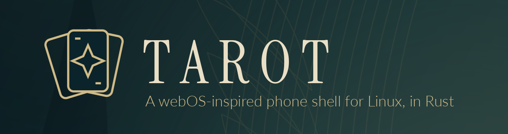
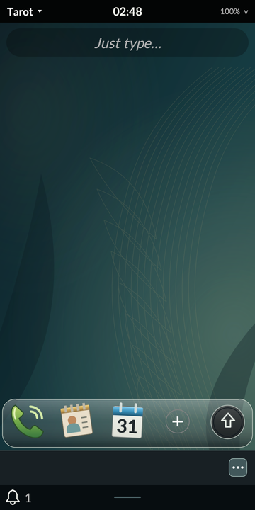
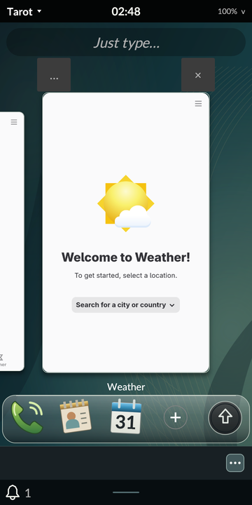
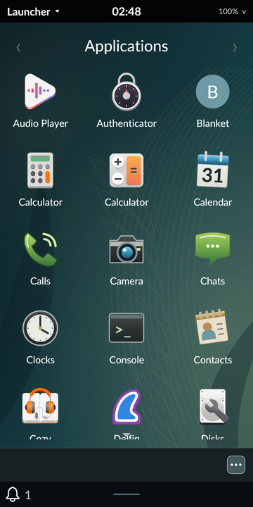
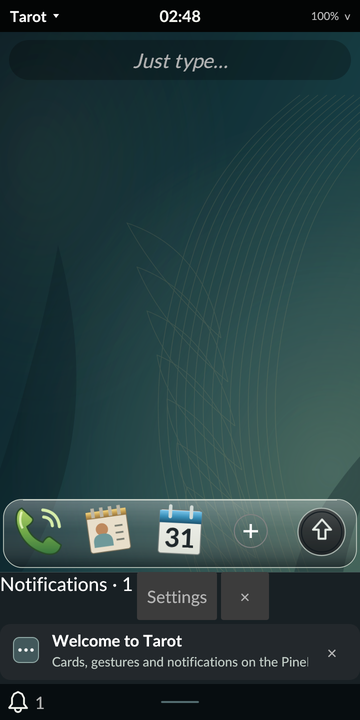
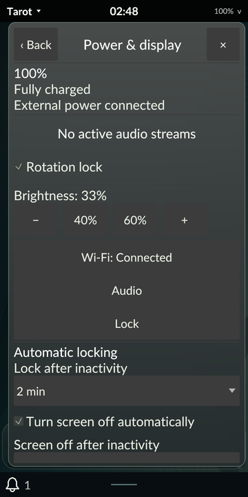
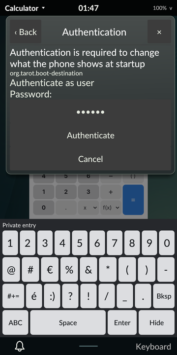

<p align="center">
  
</p>

**Tarot** is a phone shell and Wayland compositor for Linux, written in Rust. It
brings back the feel of the classic webOS phones: live **cards** you flick
through and toss away, **stacks** of related cards, a gesture area, banner
notifications that stay out of the way, and **Just Type** search. Underneath,
it runs ordinary Linux applications such as GTK, Qt, terminals and Firefox, each
as its own card.

Tarot is developed on a **PinePhone Pro** running Nura. Its shell is drawn with
[egui](https://github.com/emilk/egui) on a [Smithay](https://smithay.github.io/)
compositor, and its visual design, **Nocturne**, is an original design system
modeled on the Pre 2-era webOS 2.x interaction style.

> **Status: early development preview.** Tarot boots, locks, sleeps and runs
> real apps on the phone today, but it is not yet a daily-driver phone OS.
> Calls, SMS and contacts are still ahead. See [what works](#what-works-today)
> and the [roadmap](#roadmap).

## Screenshots

Real screenshots from a PinePhone Pro running Tarot (revision 62):

| Home | Cards | Launcher |
| :---: | :---: | :---: |
|  |  |  |
| **Notifications** | **Power & display** | **Authentication** |
|  |  |  |

The [Nocturne design packet](docs/Tarot_Design_Packet/README.txt) shows the full
intended look, including screens that are not built yet.

## What works today

- **Cards and stacks.** Native apps open as cards. Swipe through them, flick
  up to close, drag one card onto another to stack it, and rearrange or
  separate them again. Switching never relaunches an app.
- **Launcher and Just Type.** Named launcher pages, a Quick Launch dock you
  can edit, and search over apps, settings and notifications, with web and
  URI handoff.
- **Real Linux apps.** GTK 3/4, Qt, the foot terminal, Firefox and egui apps
  run with their dialogs, popups, fullscreen modes and clipboard. A
  [compatibility record](docs/APPLICATION_COMPATIBILITY.md) tracks what has
  been tested.
- **Tarot's own on-screen keyboard.** A trusted Rust keyboard types into apps,
  terminals (with Ctrl/Alt and arrows) and password fields.
- **Notifications and media.** A standard freedesktop notification server with
  banners, a dashboard, actions, do-not-disturb and preview hiding, plus
  play/pause and track controls for any MPRIS media player.
- **System controls.** Wi-Fi with password entry, audio output, input and
  device modes, brightness, battery, Bluetooth pairing, vibration profiles,
  hardware buttons and rotation.
- **Security.** The screen locks before anything is shown, unlocking uses the
  real system password (PAM), and Tarot has its own Polkit authentication
  agent. Locked content can't be captured or reached by input.
- **Sleep.** Protected suspend and resume with the phone's real hardware,
  opt-in automatic sleep after the screen turns off, and a choice to boot
  straight into a locked Tarot or show the login screen.

Everything above has been exercised on the phone itself. Each feature's tests,
evidence and known limits are recorded in
[implementation status](docs/IMPLEMENTATION_STATUS.md) and
[progress notes](docs/PROGRESS.md).

## Quick start

### Try it on a Linux desktop

Tarot runs nested inside an existing desktop session for development. You need
Rust 1.89 or newer, a C linker, libxkbcommon development files, and the Wayland,
EGL and GLES runtime libraries.

```sh
git clone https://github.com/timschmidt/tarot.git
cd tarot
cargo run --bin tarot                 # the shell in a window
cargo run --bin tarot -- -- gtk3-demo # with a native app as a card
```

Press **F1** for the card view and **F2** for the launcher, or use the gesture
strip at the bottom. If your GPU driver shows a blank window, use Mesa's
software renderer:

```sh
TAROT_SOFTWARE_RENDERER=1 ./scripts/run-nested.sh -- gtk3-demo
```

Run the test suite with `cargo test --workspace`.

### Install it on a PinePhone Pro

Tarot installs as an ordinary Nura package next to the existing Phosh session,
which stays available as a fallback. You pick **Tarot** in the login screen's
session list. See [packaging and installation](docs/PACKAGING.md) for building
the package, and [building and diagnostics](docs/BUILDING.md) for
cross-compilation, device access and recovery.

## How it fits together

| Piece | What it does |
| --- | --- |
| `tarot` | The Wayland compositor and shell: cards, gestures, launcher, notifications, system menus, lock enforcement |
| `tarot-session` | Starts the shell inside a real authenticated login session |
| `tarot-lock` | The trusted lock screen, which checks passwords through PAM |
| `tarot-keyboard` | The on-screen keyboard |
| `tarot-core` / `tarot-ui` | The platform-independent shell model and its egui views |

Tarot-owned code is Rust. Standard Linux services (NetworkManager, UPower,
PulseAudio, BlueZ, elogind, Polkit, feedbackd) provide the platform. The
[architecture](docs/ARCHITECTURE.md) describes the boundaries, rendering and
protocols.

## Roadmap

| Milestone | Focus |
| --- | --- |
| M0–M3 | Feasibility, interaction model, native app windows, and a recoverable phone session (largely in place; evidence gaps remain) |
| **M4** | **Shell alpha: services, keyboard, locking and power (in progress)** |
| M5 | Phone, Messages and Contacts apps with real calls and SMS |
| M6 | Beta: performance, accessibility, compatibility and endurance |
| M6A | Android apps as Tarot cards through Waydroid |
| M7 | Gold theme, LG Fx0 support and a reusable device layer |
| M8 | HP Pre3 |

The [development plan](docs/DEVELOPMENT_PLAN.md) defines each milestone's full
scope and acceptance criteria.

## Documentation

- [Development plan](docs/DEVELOPMENT_PLAN.md): scope, milestones, acceptance criteria and risks
- [Implementation status](docs/IMPLEMENTATION_STATUS.md): what has been demonstrated, with evidence
- [Progress notes](docs/PROGRESS.md): revision-by-revision history and detailed feature notes
- [Architecture](docs/ARCHITECTURE.md) and [interaction design](docs/INTERACTION_DESIGN.md)
- [Design application](docs/DESIGN_APPLICATION.md): how the Nocturne packet maps to the implementation
- [Building](docs/BUILDING.md) and [packaging](docs/PACKAGING.md)
- [Device baseline](docs/DEVICE_BASELINE.md) and [research notes](docs/RESEARCH.md)

## License

Tarot's own code and original design assets are available under either the
[MIT](LICENSE-MIT) or [Apache 2.0](LICENSE-APACHE) license, at your option.
Adapted upstream code keeps its [original attribution](third-party/README.md),
and the bundled Lato and Instrument Serif fonts use the SIL Open Font License.

Tarot is an independent project inspired by webOS and LuneOS. It is not
affiliated with or endorsed by LG, HP or Palm. webOS is a trademark of its
respective owner.
