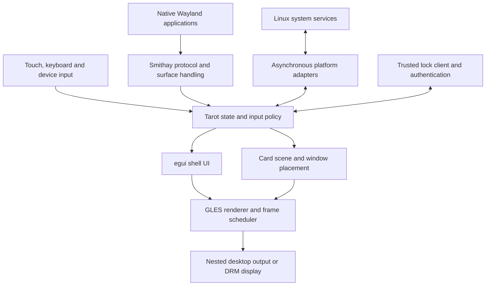

# Tarot architecture

Proposed architecture, October 26, 2026. The confirmed product is a Rust phone shell using egui, running native Linux apps on Nura and PinePhone Pro. The implementation choices below must pass milestone M0 before becoming the dependency baseline.

## Compositor and shell ownership

Build a Smithay Wayland compositor with an integrated egui shell. Smithay handles platform and protocol mechanics; Tarot owns card management, placement, focus, gestures, policy, and shell presentation. egui supplies the shell's widgets and drawing. Native application windows remain Wayland surfaces managed by the compositor.

An ordinary fullscreen eframe application cannot fulfill this role. eframe can optionally host a UI preview, but the production session needs compositor ownership of surfaces, input, output, and locking. Smithay's documented backend and protocol boundaries support this division. [Smithay architecture](https://smithay.github.io/smithay/smithay/), [egui host integration](https://docs.rs/egui/latest/egui/#integrating-with-egui)

Use one compositor/UI process initially, a separate trusted locker (now an opt-in prototype), and separate processes for substantive Tarot applications. Keep platform I/O behind narrow interfaces; extracting it into a service process later should not change the UI model. Splitting the entire shell into another process at the outset would add IPC, surface-export, and synchronization work before rendering is proven.

## Repository boundaries

Introduce a small Cargo workspace during implementation, growing it when boundaries become real:

| Component | Responsibility | Introduce |
| --- | --- | --- |
| `tarot-core` | IDs, card/stack state, navigation, gesture decisions, commands, events, animation timing, and policy tests; no graphics or D-Bus dependency | M1 |
| `tarot-ui` | egui shell views, shared keyboard view, design tokens, accessible widgets, and preview fixtures | M1 |
| `tarot` | Compositor binary, Smithay integration, event loop, rendering bridge, nested and device backends | M0 experiment, organized in M1 |
| `tarot-keyboard` | Trusted Wayland input-method/layer client, egui key UI and GLES rendering | Initial M2 text experiment implemented; broader integration pending |
| `tarot-egui-probe` | Ordinary eframe/xdg-shell diagnostic with independent windows, text fields and opt-in synthetic reports | M2 application compatibility fixture |
| `tarot-platform` | Mock and real adapters for networking, power, notifications, audio, sensors, and telephony | Mock interface in M1; real adapters in M4 |
| `tarot-lock` | Opt-in trusted egui session-lock client and disposable same-user PAM worker | M4 prototype; integration pending |
| `tarot-wayland-egui` | Shared Wayland/EGL/GLES egui renderer for the keyboard and locker | Implemented |
| Tarot applications | Settings, dialer, messages, contacts, and later utilities as separate Rust binaries | Settings in M4; phone apps in M5 |

Begin with modules inside these components; avoid a crate per icon, protocol, or service. Keep generated protocol bindings and unsafe platform code out of the pure state model. Require a reason and safety explanation for each Tarot-owned unsafe boundary.

## State and event flow

Retain domain state independently of egui's immediate-mode widget evaluation. A model update consumes an event and returns state changes plus explicit effects. The view reads a snapshot and emits commands. A service completion becomes another event, allowing the same behavior to run against mocks.

Use stable `AppId`, `WindowId`, `CardId`, `StackId`, and `NotificationId` values. A Linux process, application ID, top-level window, and card are distinct objects. One application may have multiple cards; child dialogs and popups normally belong to their parent card. Closing a card asks that top-level to close and does not implicitly terminate every process belonging to the app.

Keep navigation states such as home, focused app, card overview, launcher, and search separate from overlays such as system menu, notifications, keyboard, and incoming call. Keep session states such as locking, locked, sleeping, and resuming outside ordinary navigation. Explicit precedence prevents an app launch or delayed notification from dismissing a lock screen.

The deck now maintains contiguous stack membership in its ordered card list. Typed drop targets distinguish inserting next to an individual member from creating a standalone card before/after a whole stack. Placement checks both identities and closing state before mutation; it changes no native process or focus. Selected-window removal prefers a remaining stack sibling. Presentation derives member/group spacing from that same order and supplies a shared back-to-front list for native elements, egui chrome and hit tests.

Arrangement is a gesture preview, not speculative model mutation. A monotonic hold deadline arms it even without motion events, and bounded edge deadlines page the captured deck. View, selection or deck changes invalidate a pending drop. A release commits one placement command; cancellation settles from the displayed geometry to the unchanged model. Native app buffers remain render elements throughout. The card-menu state suppresses underlying card gestures, and menu transitions cancel outstanding routing. Stack identity, native window identity and application/process identity remain separate.

Run Wayland dispatch, input arbitration, rendering, and state ownership on the compositor thread using calloop. Service workers may use an async runtime, but must communicate through bounded channels and wake the event loop. Never await a modem request, image decode, filesystem scan, or authentication operation during rendering. Coalesce replaceable status updates; preserve ordered user actions and protocol events. Handle cancellation, timeouts, reconnects, and stale responses with request IDs or generations.

## Rendering and scheduling

Use EGL/OpenGL ES through Smithay as the first renderer. The target Mali-T860 is a Panfrost GLES device; Vulkan is not the baseline. Start with Smithay's glow integration and a compatible `egui_glow` painter. Their documented APIs make this plausible, while context sharing and GL state restoration remain M0 experiments. [Panfrost support table](https://docs.mesa3d.org/drivers/panfrost.html), [Smithay glow renderer](https://smithay.github.io/smithay/smithay/backend/renderer/glow/index.html), [egui_glow state behavior](https://docs.rs/egui_glow/latest/egui_glow/painter/struct.Painter.html)

The pinned Smithay 0.7 source is patched locally with the exact upstream bounds-intersection fix for accumulated SHM damage. Damage history can cross buffer sizes even when the cached texture matches the current buffer. Every partial upload is clipped to the current buffer extent. Desktop and phone regressions check hidden grow/shrink, fresh pixels and GL diagnostics; retain this patch until a selected release includes it. [Source and attribution](../third-party/README.md#smithay-gles-damage-backport)

The initial scene has wallpaper, card decoration, transformed client surface trees, shell controls, and privileged overlays in an explicit order. Keep native clients in Smithay's buffer lifecycle. Prefer transforming existing render elements for cards; use bounded offscreen composition where clipping or grouped effects require it. Never read every client frame back to the CPU to build thumbnails.

Native card corners now use a GLES texture shader around the existing cropped surface-tree elements. The shared animated radius comes from the packet's 11-unit pre-scale token and reaches zero in the active app. Every child uses the same card mask, including opaque XRGB surfaces; conservative opaque regions exclude the rounded corners. The shader derives scene coordinates from the actual frame projection so nested framebuffer flips and DRM output rotation follow the same path. Masked elements retain the underlying surface identity for visibility/inhibitor accounting, but cannot bypass the mask through direct scanout. Fully clipped children are omitted. Eight retained commit mappings preserve native partial damage when the pose is unchanged; pose changes damage the whole element. These caches are pruned when surfaces/windows disappear and reset with the renderer.

An analytic shadow is a separate retained pixel element behind each native window, using the packet's scaled offset, blur and opacity. Its uniforms follow Smithay's logical pixel-element dimensions, with physical-pixel antialiasing. The mask does not allocate per-app thumbnails or paint wallpaper over corners. Chrome outlines use the same floating radius, and card activation belongs to the gesture recognizer's rounded hit test, so a transparent corner selects a visible card underneath. Initial app input also checks the rounded shape; established grabs retain their surface ownership. Protected lock/recovery surfaces, keyboard and shell chrome remain outside the ordinary-card shader.

Stack presentation now derives its three preview poses from the packet tokens, including center-based −5/0/+5-degree rotation. Selected members come to the front; at most three live previews are shown. Older members remain hidden with their identities intact, and browsing brings each selected member forward. Neighboring groups use the inactive scale. A shared uniform fit keeps the whole fan above the tray in short/landscape outputs, reserving the current controls and caption without changing member aspect ratios. These are proposed packet poses, not measured historical animation.

Folded groups occupy one visual deck position each. Their placement uses group order, independently of the logical 48-unit member-browse distances. Accumulating member steps into the group's visual position can push a three/five-member neighbor entirely offscreen. A failing-before/passing-after regression covers both directions; the real-client matrix groups, browses and activates every retained member through input rather than a test-only placement command.

For a rotated native element the wrapper reports the rotated bounding rectangle, then reconstructs native sample coordinates inside that quad in the fragment shader. It reuses the existing linked `tex_matrix` supplied by Smithay, preserving the native crop, buffer orientation and texture inversion, and the existing renderer still owns import, synchronization and buffer release. Each child also clips to its own inverse-mapped rectangle. The output crop follows rotation. Rotated elements conservatively report no opaque region; retained partial damage rotates to conservative bounds, while pose changes fully damage the element. Shadows and floating outlines use the same pose. Input first undoes rotation about the exact rounded physical target center, then applies the existing inverse Fit/CENTER and surface origin. No GL projection mutation, CPU readback or additional third-party patch is required.

The implemented shell uses separate owned wallpaper and transparent foreground textures. Wallpaper is generated from original vector geometry and cached until extent/scale changes. Menus, controls and card chrome render above native content; the restricted native keyboard remains above the shell foreground in its reserved region. A stack-menu capture exposed why one combined wallpaper/chrome texture behind applications was insufficient: its invisible menu still received input. The corrected layering was verified with actual phone captures. Each stack supplies one representative title/contour so hidden member decoration does not draw through its front native window. The extra full-output RGBA wallpaper texture adds a fixed allocation; earlier memory observations predate it and require a later profiling refresh.

The rendering experiment must establish:

1. A compatible glow type/version and one clear owner of the EGL context. Do not cast between incompatible crate types to make them appear compatible.
2. Correct shell drawing through a custom render element or an owned offscreen shell texture, with explicit damage and synchronization. Select one approach after measuring.
3. Correct blend state, premultiplied alpha, color handling, scissor coordinates, orientation, and scaling across both renderers.
4. Texture allocation, updates, deletion, context loss, and render-target lifetimes without destroying client-owned resources.
5. Correct DMA-BUF import, modifiers, buffer release, and synchronization through Smithay. Do not assume a client buffer is an ordinary egui texture.

Use output presentation timing to schedule animation. Rebuild egui output when its inputs, model, or animation change; reuse shell drawing while only a video client changes. Respect repaint deadlines and output damage, and stop animation timers when settled. Throttle hidden app frame callbacks without arbitrarily killing or freezing their processes. Audio and background services may still need to run.

Frame callback eligibility now follows visible Wayland connections as well as individual windows. A toolkit can render a hidden primary window on the same thread as its visible secondary window; withholding all callbacks from the primary can block EGL swap and freeze input for both. All windows on a connection with visible content receive foreground callbacks. Other hidden windows receive callbacks at most four times per second, only when a committed surface tree actually has a pending request. A separate background deadline avoids delaying foreground pacing behind a background timer. Hidden callbacks indicate that a client may draw again; they do not claim its hidden buffer was presented.

Reserve expensive live blur, elaborate shaders, and direct scanout for measured follow-up work. Direct scanout must be disabled whenever it would bypass required shell or lock content. Bound card snapshots and release resources promptly when clients disappear.

### Output geometry and orientation

The nested and DRM backends share `OutputGeometry`: physical extent, scale, current/requested orientation and a geometry revision acknowledged by presentation. DRM applies a pending change only with no outstanding page flip; a completion queued for an older revision cannot release a current lock or sleep barrier. Scene extents use the transformed dimensions while native scanout retains the physical panel size. The nested framebuffer flip has its own composition with the inverse orientation; native pixel tests are required alongside nested tests.

Input uses the same orientation and geometry as rendering. A geometry change cancels active contacts/gestures, suppresses stale held-button release, reprojects stationary pointers, settles old-coordinate animation and invalidates cached hit maps. App, keyboard and trusted-lock configurations follow the new logical extent. Obsolete lock buffers yield opaque fallback; unlock requires a full-size protected surface presented in the current geometry. The trusted live role still receives frame callbacks to unblock a replacement buffer; callbacks do not count as presentation proof. Client callback generations ignore late completions after configure.

The SensorProxy worker owns the standard system-bus connection, validates the root service owner, subscribes to property/owner changes and publishes coalesced snapshots through calloop. Owner epochs reject stale events; unavailable or undefined orientation retains the current display. Rotation lock, inactive seat, panel off and sleep preparation release its claim. The current source persists the checkbox and its locked orientation through the shared preferences worker. Revision 5 independently verifies real panel-off accepted claim release/reclaim. Revision 8 verifies persistent settings, protected landscape restart and actual touch/PAM in all four orientations. Native revision 5 verifies rotated KMS/input/keyboard and physical sensor directions; endurance remains specific to each tested binary.

## Input and text entry

Normalize touch input into logical output coordinates after applying display rotation and scale. Preserve contact IDs, timestamps, cancellation, and seat focus. The core gesture recognizer chooses an owner; egui receives only shell-owned input and clients receive only their own sequences.

Initially reserve a visible software gesture strip. Touches starting there belong to the shell; touches starting inside an app remain with that app. This avoids speculative input delivery followed by accidental clicks. A future fullscreen edge gesture may take over only with a defined Wayland touch-cancel policy. Card thumbnails are shell controls: tapping one activates the window, and subsequent gestures interact with the enlarged app.

Native pointer/touch focus uses a surface target that converts output coordinates at event delivery, after Smithay applies its grab ownership. Both rendering and input use the same cached physical reference/target rectangles and Fit/CENTER rounding. This lets a held contact follow a changing card transform without changing its focused surface. Smithay's initiating-surface touch grab is retained across additional contacts. A pinned 0.7 cancellation workaround requeues each active contact's last position without a frame before canceling, because its normal cancellation path skips already-framed contacts; a client can receive a duplicate final motion immediately before cancel. The real native-client replay verifies this behavior. [Pinned touch implementation](https://docs.rs/crate/smithay/0.7.0/source/src/input/touch/mod.rs), [grab policy](https://docs.rs/crate/smithay/0.7.0/source/src/input/touch/grab.rs)

The implementation caches each rendered surface's current origin and owning window, including subsurface and popup trees. Held focus retains surface identity while its coordinate origin can change with a later frame. Traversal callbacks use their supplied surface state, because re-entering the surface lock deadlocks. The moving-child replay commits both child and parent; parent-only positioning and other synchronization combinations still need coverage.

Popup grabs belong to the active parent card and seat. A bounded recent-input ledger checks the triggering serial; an active nested grab may reuse its parent's serial. Smithay enforces popup hierarchy and rejects late grabs. The top popup receives keyboard focus, while ordinary owner-client pointer/touch delivery continues. Navigation dismisses the popup stack before changing shell focus, and destroying a touched popup cancels the native sequence. Placement constraints are computed in the eventual focused card's inverse fit coordinates, reserving status and gesture-strip space. This is implemented and exercised with the protocol fixture and GTK4 menu; broader pointer, repositioning and toolkit cases remain. [Pinned popup grab implementation](https://docs.rs/crate/smithay/0.7.0/source/src/desktop/wayland/popup/grab.rs)

The initial text-input-v3/input-method-v2 bridge now uses pinned Smithay dispatch and its keyboard-focus integration. `--input-method PROGRAM` launches the trusted helper with a private inherited `WAYLAND_SOCKET`; repeatable `--input-method-arg` values remain typed arguments. Only that connection's client data permits viewing/binding the input-method global. Ordinary client connections never receive that capability. The compositor does not log text content; the separate synthetic test probe deliberately records fixture text for verification. Native and nested replays cover composition, byte offsets, stale transactions, focus/disable isolation, an untrusted bind and helper exit. A real GTK4 entry also accepts preedit and Unicode commits on the phone. Candidate-popup handlers are wired into the native popup tree but still need geometry/lifecycle tests. [Pinned input-method integration](https://docs.rs/smithay/0.7.0/smithay/wayland/input_method/index.html)

The initial `tarot-keyboard` process now supplies an actual egui/GLES keyboard. It creates a restricted layer-shell overlay with no keyboard interactivity, and its touch/pointer input uses a direct surface-to-output mapping rather than an app-card fit transform. Layer-shell and virtual-keyboard managers use the same trusted-client filter as the input-method manager. The compositor accepts only its keyboard namespace/anchors, bounds height to half the output, reserves app geometry above the gesture strip and clips the layer to that allocation. The native keyboard requests 240 logical pixels. An owning app ID prevents a delayed keyboard frame from appearing over another card or overview. Helper/layer destruction cancels held touch and restores the app area.

The client uses glutin and the system Wayland/EGL connection with an egui_glow painter; its EGL objects are destroyed before their Wayland surface. Rendering follows Wayland frame callbacks, honors positive egui repaint deadlines and stops when settled. Initial configure/scale changes receive two additional layout frames. Native text commits carry letters/symbols; Backspace respects UTF-8 selection and grapheme boundaries, with a restricted virtual-key fallback when no surrounding context is available. Enter also uses the virtual-keyboard protocol. The helper drops retained surrounding context for private purposes/hints and logs no typed text; compositor debug touch logs omit coordinates. The egui fixture verifies password-purpose presentation and the context-free Backspace fallback; broader purpose/toolkit behavior still needs runtime verification. A trusted physical keyboard remains useful during integration.

The key view lives in `tarot-ui` and emits typed `tarot-core::KeyboardAction` values. Native fields use that view in the separate Wayland helper; shell search hosts it directly in the compositor's egui scene. Shell keys become egui text/key events only while launcher search owns text focus. Keyboard touches preserve that focus, while Hide or Enter ends editing and retains the query. Results use the remaining area and the dock is hidden during entry. No internal Wayland application is needed for a shell field. The egui host also checks press distance before retaining multi-click history: pinned egui 0.33 otherwise interprets rapid taps across distant controls as a double-click, which selected the whole search query during a real phone replay.

The app-view gesture strip offers a Keyboard action without changing native text focus. A second private inherited socketpair carries only show/hide/quit bytes to the helper; it is nonblocking and carries no text. Child monitoring distinguishes applications from input-method generations. On helper exit, the compositor revokes that trusted Wayland client before replacement, preventing stale privileged resources from surviving. Restart delays are 250, 500, 1000, 2000 and 4000 milliseconds; a sixth consecutive failure stops automatic retries. A helper alive for at least thirty seconds resets this history on its next exit. The Keyboard action also retries after exhaustion. Generation checks discard obsolete timers/exits, and pidfd shutdown targets the owned process identity. Real phone replay covers reopening and a held-key crash/restart without an accidental edit; a nested `/bin/false` run verifies retry exhaustion. Manual retry after exhaustion remains to be exercised end to end.

The shared key view has letter and two symbol pages covering every printable ASCII character. Symbol-page switching is separate from one-shot letter Shift and is included in the egui multi-pass frame snapshot. Shell private entry and native text fields use the same key actions. Tests verify the exact ASCII range through private-widget pointer events and native phone touches.

Keyboard behavior includes focus, show/hide, content purpose, password mode, preedit, commit, surrounding text, selection, and cursor location. The keyboard must not steal the app's text focus. Adjust the usable app area with configure/ack handling instead of covering fields and hoping applications scroll correctly. Test non-ASCII input and composition before claiming international text support.

Ordinary first-party egui clients use the shared `tarot-ui::native_text` host adapter with the pinned egui/egui-winit 0.33 integration. Bare Wayland commits otherwise reach TextEdit without a new composition cursor and subsequent commits can be discarded. The adapter starts only bare compositions, preserves real preedit/cursor validation, and keeps state per viewport, including immediate child viewports. It retains no text. Actual TextEdit tests cover repeated Unicode commits, Backspace, preedit replacement and rejecting a commit after the cursor moved. Keyboard commits remain one atomic protocol transaction: attempting two transactions as a toolkit workaround let a surrounding-context reply invalidate the second transaction. External unadapted egui clients still need their own compatible toolkit integration; compositor protocol support cannot establish that every toolkit revision works.

The locker and an external Tarot keyboard need client-side Wayland integrations for their actual surface roles. An ordinary eframe/xdg-shell window does not become a lock or input-method surface by drawing the corresponding UI. Include those client bindings and their egui rendering/input integration in the helper implementation estimates.

## Wayland compatibility contract

The implemented [transient-window policy](TRANSIENT_WINDOWS.md) separates native toplevel identity from root-card ownership. Parented members share the card's pose and clipping, retain individual native geometry/input, and use the optional xdg-dialog modal hint separately from parenting. Effective relationships account for mapped-parent and orphan/remap semantics. Native fitting and input share the pinned Fit/CENTER offset; surface trees clip at the family card rather than the individual dialog, preserving popup overflow and decorations. Revision-20 protocol pixels/input check that overflow and the outer rounded boundary in every orientation; GTK3/Qt6 long menus require real selections beyond conservative dialog bounds. Native protection uses real PAM. Client window-state hints and broader toolkit gates remain open.

Advertise only interfaces and versions whose lifecycle is implemented. This list is an implementation target, not a claim that the blank project supports these protocols.

| Stage | Protocol capabilities | Required behavior |
| --- | --- | --- |
| M0 | Minimal compositor, shared memory, output, seat, xdg-shell | One real client maps, renders, receives input, and closes |
| M2 | xdg toplevels/popups, subsurfaces, pointer/keyboard/touch, selections and clipboard, DMA-BUF, viewporter, output scale and transforms | GTK, Qt, terminal, and egui clients work as cards; correct configure/ack, grabs, dialogs, focus, and buffer lifetime |
| M2 text experiment | text-input-v3, input-method-v2, and the keyboard's required layer-shell subset | Real keyboard entry into shell and external app fields; correct focus and cancellation |
| M3 and M4 | presentation timing, idle/inhibit handling, layer-shell policy, activation tokens, session lock, applicable decoration support | Usable device session, power coordination, notifications, and secure lock |
| M6 compatibility | Fractional scaling if needed, drag/drop completion, XWayland, portals, and controlled screen capture | A published tested application matrix; unsupported paths remain explicit |

At scale 2, the phone's physical 720 by 1440 panel provides approximately 360 by 720 logical units before shell reservations. Begin with integer scaling; keep the model ready for other scales. Add desktop-app accommodation, such as an explicit per-app scale setting, after measuring real minimum-size behavior.

Input-method, virtual-keyboard, capture, data-control, and similar privileged capabilities require client filtering. App IDs and window titles are presentation metadata, not credentials. Portal permission decisions and lock state must also constrain capture and clipboard paths.

## Platform adapters

| Adapter | Initial integration | Specific work |
| --- | --- | --- |
| App registry and launcher | Desktop entries, XDG directories, activation | Watch changes; parse field codes and quoting correctly; handle `DBusActivatable`, desktop visibility, icons, URI handlers, and launch failure. Never interpret `Exec` as arbitrary shell text. |
| Notifications | Rust service owning `org.freedesktop.Notifications` | Capabilities, replacement, actions, expiry, close reasons, bounded content, and lock-screen privacy. Keep history distinct from live actionable notifications after sender exit. |
| Network | NetworkManager through zbus | Wi-Fi scan/connect, reconnect, state signals, secret-agent flow, and Polkit authorization. Let the platform manage saved credentials. |
| Power and display | UPower plus selected login/session service and output backend | Battery/charging, brightness, idle, display off, inhibitors, suspend/resume, and service restart. Brightness and suspend are separate from battery reporting. |
| Audio | Standard libpulse control; current phone uses PulseAudio 17, with PipeWire-compatible API | Volume, mute and default output have an initial implementation. Complete profiles/ports, microphone, per-app routes, physical hotplug, call audio and headset behavior; retain platform policy. |
| Bluetooth | BlueZ through zbus | Discovery, pair/connect/disconnect, pairing prompts, and airplane-mode policy. |
| Sensors and feedback | Existing sensor/feedback services where available; narrow device adapter otherwise | Orientation, ambient light, proximity, vibration, and hardware buttons; capability detection and missing-device handling. |
| Telephony | ModemManager through zbus | SIM state, registration, calls, SMS, and data-state coordination with NetworkManager; no competing direct modem control. |
| Authentication and authorization | Platform PAM/authentication path and Polkit agent | Authenticate outside rendering; avoid storing a second plaintext credential database; support required system-action prompts. |

These use standard platform APIs rather than recreating their daemons. The [research service matrix](RESEARCH.md#native-application-and-service-integration) links the API sources. Each adapter exposes available, unavailable, connecting, ready, and error states; an absent daemon must not crash the session.

The first real notification adapter is `src/notifications.rs`, with a deterministic lifetime/action store in `tarot-core` and banners/dashboard in `tarot-ui`. A dedicated zbus connection owns the standard name with `DoNotQueue`; an existing server is retained. A worker performs outgoing D-Bus calls/signals and waits for the nearest expiry rather than polling continuously. Short incoming methods validate bounded fields and update the store. Coalesced snapshots reach calloop through a ping; the worker command queue is bounded to 64 and retained entries to 64. Routine diagnostics expose lifecycle metadata, without bodies, summaries or action keys.

IDs are monotonic within a server lifetime. Replacement keeps the ID and advances a revision, invalidating stale UI actions and old deadlines. A live entry belongs to its unique D-Bus sender; other connections cannot replace or close it. Action/close signals target that unique connection. A disconnected sender's content can remain visible, but its actions are disabled. Closed retained history is explicitly separate from live entries. Name collision or bus loss leaves the compositor usable with an unavailable state. A worker retries at 250/500/1000/2000/4000 ms, then every four seconds, while still accepting local settings/history actions. Thirty seconds of healthy operation resets backoff. Existing owners are never replaced or queued behind; releasing the name allows recovery.

Each connection attempt has an epoch. A retired connection cannot mutate the store after a new connection is active. Before reconnection, the old connection and owner watcher close, queued signals are discarded, transient entries are removed, and other entries become read-only orphaned history with no deadlines or actions. Notification IDs continue increasing across reconnects, so reused D-Bus unique names cannot inherit old notification ownership. Published snapshot generations include connection/settings changes independently of entry revisions. An arriving banner changes neither native focus nor an existing gesture. Opening the modal dashboard cancels held input and removes app focus; closing restores the selected native app's focus.

In notification-enabled sessions, the worker also publishes the private activation environment on each connection, before claiming the notification name. Initial bus absence therefore leaves the renderer/control/UI running while the worker retries; a replacement bus receives the display environment again. Startup app coordination and D-Bus-only application activation still need implementation. Explicit publication without the notification adapter retains the one-shot development path.

`src/preferences.rs` and its service module implement version-2 TOML preferences for notifications, rotation lock/locked orientation and idle locking/panel-off timeouts. One dedicated worker owns atomic 0600 file replacement and sync; renderer/notification workers only update bounded, coalesced in-memory desired state. Revision checks keep stale write completions from acknowledging newer settings. Shutdown flushes the latest desired file. Initial loading happens before backend initialization and notification name ownership. Existing version-1 notification policy migrates in memory and is written only after an actual user change.

Absent files use defaults. Invalid/unsupported, oversized, nonregular, foreign-owned or symlink files encountered at startup are preserved; runtime changes apply but saving stays disabled until repair/restart. Invalid timeout bounds/order are rejected. A failed ordinary write is visible and a later change retries. New directories use 0700; existing directory modes remain. Notification and display UI status share the same transaction result. History and unrelated app/settings state are not persisted by this file.

Use versioned TOML for shell preferences and XDG locations for configuration, state, cache, and runtime sockets. Save preferences atomically. Keep sensitive notifications, message bodies, phone numbers, and credentials out of routine logs. Choose durable application storage, migrations, and secret storage when phone apps are introduced; a SQLite system dependency is allowed under the confirmed Rust boundary.

The first power adapter is `src/power.rs`, with typed state/conversions in `tarot-core::power` and a status/menu view in `tarot-ui::system`. `--system-services` enables it; development buses/backlight readback roots are explicit diagnostic overrides. One worker owns platform I/O, two blocking signal watchers wake it for relevant property/name changes, and a bounded command channel/coalesced calloop snapshots connect it to the shell. Healthy battery updates use signals. Backlight readback refreshes once per second while the menu is open; unavailable services retry at bounded intervals. A healthy closed menu has no periodic refresh timer. Bus loss closes watchers/connections and reconnects with bounded backoff.

UPower's display device supplies presence, percentage/coarse level and charge state; `OnBattery` is separate external-power information. An online supply does not imply charging. Brightness discovers a single backlight, reads its range/requested/actual values, and sends writes to `org.freedesktop.login1.Session.SetBrightness` through the caller's active local session. The compositor never writes sysfs or asks for global write permissions. UI requests are limited to 5–100 percent; display off belongs to future idle/lock policy. Pending state retains the observed level, and successful completion requires driver readback of the quantized target. Denied or mismatched requests retain an action error until another attempt. Missing services, invalid ranges, nonlocal sessions and multiple backlights disable controls with explicit state.

The system menu is mutually exclusive with the notification dashboard. Opening it cancels input/focus through the existing modal path and hides the native keyboard; closing restores the selected app/field. Incoming power updates change only their snapshot and redraw state. The root-only `local-session` example is a development fixture for the bounded phone harness, not a production privilege broker. It registers only its own gated child as a temporary local elogind session and restores/releases the experiment on exit. Normal packaging must use the authenticated greeter/PAM session path.

The first network adapter is `src/network.rs`, with typed state/actions in `tarot-core::network` and `tarot-ui::wifi`. The same `--system-services` flag enables it. A worker owns D-Bus I/O, a bounded 64-command queue receives intent, two signal watchers coalesce wakeups, and calloop receives coalesced snapshots. Healthy operation has no periodic refresh or automatic scan timer. The worker waits for signals or its nearest operation deadline; unavailable services retry at bounded intervals, and bus reconnection uses 250–4000 ms backoff. The diagnostic `--platform-bus` override applies to both system-service adapters.

The initial adapter requires exactly one NetworkManager Wi-Fi device and leaves USB, cellular and other devices alone. It groups access points by raw SSID bytes and security class, selects the strongest compatible AP at activation, and obtains nonsecret saved-profile settings through `GetSettings`. It never calls `GetSecrets`. Profile compatibility includes raw SSID and key-management checks; an open network cannot inherit a personal-security profile. Rows/profiles carry opaque monotonic tokens, pruned when their identities disappear and retired across owner/bus replacement. Reads and actions target NetworkManager's unique owner so a replaced daemon cannot receive an old request through a reused object path.

Permissions distinguish allowed, authentication-required and denied. Only already-allowed actions are enabled; a Polkit agent remains future work. Acknowledged RPCs remain pending until `LastScan` advances, radio/device state confirms the request, or the requested active connection, saved profile and AP group are observed together. Scan/radio/disconnect operations time out after 20 seconds, activation after 45 seconds. An active password prompt extends the activation deadline, with its own 90-second expiry. An observed activation replaced by another connection is retired. Failure and timeout feedback is separate from observed connection state. Routine metadata omits SSIDs, profile names/UUIDs, BSSIDs, addresses, object paths and passwords. Captures can contain network names and remain private development artifacts.

Visible open/personal networks now have a new-profile form. `AddAndActivateConnection2` receives raw SSID, explicit AP/device, the key-management mode and a UID-resolved private user permission. Remembered profiles use NetworkManager's disk persistence; temporary profiles use volatile persistence and are deleted on disconnection. Both use system-owned secret flags: NOT_SAVED would discard an initial supplied password before activation. Tarot maintains no password file or general credential cache. New-profile creation requires both network-control and modify-own permission. Account naming currently resolves the effective UID through `/etc/passwd`; other account providers need integration.

`src/network/agent.rs` registers a standard secret agent on the same connection and retries registration failure. It supports interactive personal-network requests only for a profile explicitly armed by a user connection action. Caller identity is checked against the live unique NetworkManager owner before prompting and again after input. Requests must match profile path, raw SSID and key-management mode. One bounded pending reply has a monotonically increasing token; stale replies, daemon cancellation, expiry, service loss and shutdown cannot retain a live form. GetSecrets awaits an asynchronous one-item channel rather than blocking the compositor or zbus executor. SaveSecrets reports unsupported local storage; DeleteSecrets is a no-op for the empty store. NetworkManager retains control of its own saved secrets. Agent-owned persistent storage, enterprise/VPN credentials and automatic background prompts are not implemented.

The password form shares the Rust key view with a private-entry label and renders only bullets. Its owned, bounded buffer has redacted Debug and zeroizes on drop; control-request text is also zeroized. It does not put plaintext in egui TextEdit/undo state or expose its value through status metadata. Physical password input is intercepted before ordinary egui/native-app text routing. Input-library, D-Bus marshalling, OS and QA-script copies are outside that buffer guarantee. Closing/navigation cancels the form, clears the buffer and retires the request token; an old queued snapshot cannot reopen it.

Remembered profiles use NetworkManager-owned disk storage rather than an agent-owned credential database. Native QA verified private profile permissions, persistent filename, Unsaved=false and a mode-0600 root-owned keyfile, then reconnected without entry in a different compositor process. NetworkManager was not restarted. A root-only QA ledger stores UUIDs and process identity, never passwords, and is removed with the test profile. This is compositor-session persistence evidence; daemon restart and reboot require separate tests.

The Wi-Fi page shares the modal system menu, preserving the selected native window. Shell search, its key view and the dock cannot receive input through either modal dashboard. Global NetworkManager connectivity is labelled as system connectivity: it is not proof that Wi-Fi itself has internet access. Hidden networks, enterprise credential entry, forgetting/editing profiles, additional security modes, multiple adapters, Polkit authorization and native outage recovery remain future work.

### Playback audio adapter

`src/audio.rs` owns playback output snapshots through libpulse-sys 1.23.0. A dedicated worker owns the libpulse connection and threaded mainloop; it subscribes to sink/server changes and publishes coalesced snapshots through calloop ping. The healthy worker has no periodic polling. The current phone runs PulseAudio 17. A PipeWire PulseAudio service exposes the same control API, but separate PipeWire runtime validation remains required.

`src/audio/pulse.rs` confines the FFI ownership boundary: all live loop/context/operation access is serialized by the mainloop lock, callback data has a stable owned allocation, callbacks copy call-scoped library fields, and completion/cancellation precedes destruction of request data. Drop removes callbacks, disconnects/unrefs the context and stops the loop without holding its lock. Connect/query/control operations have three-second bounds and observe shutdown between waits; the real private-daemon test also exits while a request is blocked.

The adapter accepts one reserved action, bounds the command queue to 64 and observed sinks to 64, and refreshes identity before dispatch. Opaque monotonically assigned IDs are retained only for matching sink name/index within a live connection; they never cross reconnects. Routine diagnostics omit names/descriptions. Volume scaling preserves channel balance and stays at or below normal volume; mute is independent. Changing the default applies to new playback and does not forcibly move existing application streams or reconfigure card profiles. Acknowledgement alone is insufficient: the target must appear in observed state before pending clears. Timeouts, disappearing outputs, invalid/stale actions and service replacement produce explicit unavailable/error state. Reconnect backs off to four seconds; no audio daemon is spawned by Tarot.

System/notification panels are explicit egui sublayers above their dismissal scrims, so an outside click cannot promote a scrim above a reopened panel. System/notification panels retain focus and their prior selection when a new native card maps. The new card is available for explicit activation after dismissal. This includes the first app finishing startup while a panel is open. Modal focus restoration remains independent of catalog launch feedback and native window existence. Hardware profiles/ports, microphone controls, per-app routing, physical audio keys, Bluetooth and call-audio coordination remain planned work.

## Locking and failures

The initial lock threat model covers unattended physical access and ordinary application clients. A Wayland compositor does not by itself sandbox all native Linux processes or defend against root and arbitrary same-user process access. Broader application isolation requires distribution policy and, where applicable, sandbox/portal integration; document that boundary with the release.

The compositor enforces protection; the separate trusted client draws and authenticates. The implemented experimental foundation uses `ext-session-lock-v1` with a private inherited socket and a per-client revocable capability. Ordinary clients cannot discover or explicitly bind its manager. The pure `LockGate` moves from Unlocked to Awaiting before starting a client, then Preparing and Locked after its protocol request/presentation, or to Orphaned after owner loss; only a matching presented generation and valid owning unlock can release protection. Recovery replaces the trusted connection without exposing ordinary content. The opt-in `tarot-lock` client now supplies actual egui presentation and same-user PAM authentication; reusable activation, protected startup and bounded replacement now have native evidence; opt-in sleep/idle coordination and an installed authenticated session preview now have native evidence; broader policy and release packaging remain open. [Protocol contract](https://github.com/wayland-mirror/wayland-protocols/blob/main/staging/ext-session-lock/ext-session-lock-v1.xml)

The direct backend tags queued protected frames and sends `locked` only after the matching DRM completion, covering the entire selected panel. Nested EGL submission is a weaker development approximation, explicitly excluded from physical-presentation proof. Protected rendering contains only the live lock surface, opaque black, or the dedicated opaque recovery view after retry exhaustion; ordinary UI code, wallpaper, apps, previews, popups and the normal keyboard are excluded. Role destruction is distinct from `wl_surface` destruction and initially selects black while a replacement is attempted. QA-only framebuffer audits publish booleans, never locked pixel data.

Protection suppresses normal navigation/effects, preserves cards through background lifecycle changes, cancels grabs and clears held input on entry/exit, suppressing old releases. Only the active lock surface receives fresh input. Normal client mapping/unmapping and keyboard-helper replacement must not cancel a locker contact. Selection policy gates previously issued offers and new drag/selection requests; data already granted to a client cannot be taken back. Network secret forms are canceled, and incoming prompts are rejected while protected. Diagnostic status is redacted and captures denied, including requests scheduled before protection. Development Exit remains an operator recovery command; there is no diagnostic unlock command.

The pinned Smithay adaptation guards invalid-unlock fallthrough, checks lock-role liveness, prunes dead output resources and adds a default-allow selection request policy hook. [Local patch inventory](../third-party/README.md#smithay-session-protection-changes) Protected startup, normal lock controls and bounded locker replacement are implemented; protected user retry now has native evidence; opt-in sleep/idle coordination and the installed authenticated preview have native evidence; complete power policy and release packaging remain required. The explicit synthetic locker remains solely a protocol fixture; the actual egui client is a separate executable.

Compositor termination is a different failure: existing Wayland connections generally die, and session restart cannot promise transparent app recovery. Supervision must return to an authenticated greeter or start in a locked state, avoid restart loops, and never expose an unlocked autologin session. This needs actual device failure tests, including suspend and wake. A prototype lock animation carries no security claim.

Allow a narrowly scoped incoming-call interface while locked only after its allowed actions and privacy behavior are tested. Keep lock protection when orientation changes or another output appears. Defer external-display support until it can preserve those guarantees.

## Nura packaging and reproducibility

Use the newest supported stable Nura release as the initial provisioning default, applying its updates and verifying its device-specific boot procedure. Use edge if a documented dependency or driver requirement warrants it, with an exact package/image snapshot and recovery path. The authorized spare PinePhone Pro has been physically identified over USB and upgraded to stable 26.06 through supported release steps; retain the [observed baseline](DEVICE_BASELINE.md), rather than inferring edge boot instructions apply to it.

The first tested device configuration is OpenRC/elogind, retained through the supported upgrade of the available phone to 26.06. Direct-display experiments use a temporary seatd instance through libseat and restore greetd/Phrog on VT7 afterward. Restoring an authenticated Phosh desktop is a separate normal greetd/PAM login, verified independently in the actual-suspend checkpoint. Keep seat acquisition and service integration behind adapters; a systemd/logind configuration remains a later packaging target rather than a reason to reinstall the working baseline. Explicitly declare tested service managers in the distribution UI package. [Service-manager support](https://nura.eco/edge/2026/07/10/explicit-service-managers/)

The installed development APK now supplies a Rust `tarot-session` supervisor and Wayland desktop entry. It derives its session from the actual process through root-owned login1, validates ordinary local seat ownership, starts a private bus and uses libseat logind. Compositor failure terminates that authenticated PAM cgroup before returning to the greeter; one real installed-session crash/suspend replay has passed. [Boundary, source build and remaining gates](PACKAGING.md)

Package a normal user session, its Wayland session entry, configuration, assets, service dependencies, and recovery instructions. Do not require running the whole shell as root. Use the selected release's current APKBUILD and UI-package conventions, preserving upstream package identifiers even where they retain the previous distribution name.

Build AArch64 artifacts against the selected Nura/Alpine musl sysroot and native libraries, initially through the distribution build environment or native device builds. A desktop GNU/Linux build is not a deployable Nura binary by assumption. A fully static artifact is not a requirement because graphics and input dependencies are platform libraries. Pin the compiler, dependency lockfile, feature set, system packages, and build recipe once M0 passes; avoid enabling every default Smithay backend blindly.

## Decision register

| ID | Decision | Status and revisit condition |
| --- | --- | --- |
| D01 | Complete phone shell supporting native Linux apps | Confirmed by owner |
| D02 | Rust-owned code with normal Linux system dependencies | Confirmed by owner |
| D03 | Preserve WebOS visual and interaction design on modern foundations | Confirmed by owner; explicit adaptations in the interaction specification |
| D04 | Nura on the available spare PinePhone Pro, updated during development | Confirmed by owner; exact release and access details resolved in M0 |
| D05 | Smithay compositor with integrated egui UI | Accepted for implementation: shared renderer, native GTK client, direct panel output and basic touch demonstrated on the phone; broader protocol validation remains |
| D06 | GLES first through a compatible glow integration | Accepted for implementation: Mali-T860/Panfrost GLES 3.1 confirmed in nested and direct DRM sessions; desktop NVIDIA issue remains open |
| D07 | calloop state ownership with asynchronous service workers | Proposed; accept after event/repaint integration and service-failure tests |
| D08 | Initial OpenRC/elogind device configuration with libseat | Amended after provisioning: tested 26.06 upgrade retains OpenRC; temporary seatd experiments demonstrate direct access. An installed greetd/PAM/libseat-logind preview now has native crash/suspend evidence; release packaging and systemd support remain work |
| D09 | Separate trusted locker and separate substantive applications | Prototype has PAM and crash/replacement evidence; startup/activation/recovery are implemented; protected recovery UI has native evidence; complete power coordination and session packaging before M4 completes |
| D10 | Original implementation/artwork and an explicit source-license inventory | Accepted policy; owner selected MIT OR Apache-2.0 for Tarot-owned code. Dependency/asset inventory remains ongoing |

If shared in-process rendering proves too fragile, compare a separate egui shell client plus a narrow compositor protocol against a small custom egui render-element adapter. Preserve the product requirements while reconsidering that boundary. An existing compositor with an ordinary overlay can serve as an experiment, but does not automatically provide Tarot's live card transformations and input policy.

## Authenticated locker client

`tarot-lock` connects only through the inherited trusted connection, requests a real session-lock role, acknowledges its full-panel configuration and renders with the shared `tarot-wayland-egui` EGL/GLES host. It has no xdg-shell card, clipboard/data-device binding, input-method dependency or password TextEdit. A clock/lock puck opens private entry by tap or upward drag; the embedded shared keyboard and physical xkb keymap feed a bounded owned secret buffer. Only bullets enter egui. Cancel clears entry and layout. Input is disabled during authentication and retry cooldown, and unlock submission requires the compositor's protected-frame acknowledgement.

A fixed 512-byte allocation holds UTF-8 entry; deletion erases removed bytes and clearing/drop zeroizes the owned buffer. Full credentials never enter egui event/undo state, process arguments, environment or diagnostics. UI and worker reject root/set-ID operation and disable core dumps/dumpability. These measures do not promise erasure of every PAM/kernel/library copy or isolation from root/arbitrary same-UID code.

Each attempt execs the same binary's private worker mode with a bounded length-prefixed stdin pipe and no display environment. It resolves the current real UID through the account database; there is no user-switch or service-name override. A narrow dynamic `libpam.so.0` boundary calls the fixed `tarot-lock` PAM service, then both `pam_authenticate` and `pam_acct_mgmt`, followed by `pam_end`. Only complete success can request protocol unlock. Empty input is rejected and PAM receives `PAM_DISALLOW_NULL_AUTHTOK`; account expiry/password-change requirements fail closed. Username/password conversations are supported; repeated hidden prompts are rejected rather than reusing the password for another factor. Arbitrary module prompt/error text is not displayed or logged.

The graphics loop polls the private worker without blocking. A 15-second deadline terminates/reaps its process group, maps errors/signals to unavailable and leaves protection active. Failed attempts clear entry and enforce 2/4/8/16/30-second cooldowns within that locker instance. A parent-death signal kills an in-flight worker when its locker disappears, with a pre-exec parent identity recheck closing the fork/exec race. The compositor still owns crash protection and trusted replacement; automatic bounded replacement is implemented, while persistent authentication retry policy and production process/cgroup supervision remain separate integration work.

The staged Nura policy includes the existing `base-auth` and `base-account` stacks. It does not create credentials or open another login session. With `--lock-client` configured, the compositor reserves protection before either backend initializes. The normal menu Lock action reserves protection before spawning a fresh client; successful unlock revokes the old connection capability. The installed Rust supervisor now has one native compositor-SIGKILL test proving termination of its PAM cgroup and return to Phrog; supervisor/greeter failure cases and release reliability remain to verify. [Current device evidence](IMPLEMENTATION_STATUS.md#authenticated-rustegui-locker)

## Lock activation and recovery policy

`LockGate::reserve` creates Awaiting protection before the child is started or a backend can render ordinary content. Awaiting frames are opaque black, receive no ordinary input and cannot acknowledge/unlock a protocol owner. A trusted request creates a new Preparing generation; only that generation's presentation can acknowledge it. The first-presented protection flag records the queued scene tag (KMS completion on DRM, EGL submission on nested), and an ordinary-presentation counter supports startup regression evidence.

A configured system-menu Lock emits an effect without discarding the underlying deck/view. `request_lock` cancels private prompts/held input, closes panels, stops their service watches, reserves protection, then launches a fresh connection/process. Repeated requests while protected are idempotent. Successful owning unlock revokes that connection's lock capability; old process exits and timers cannot affect a newer generation. There is no management unlock command. Without a configured program the menu action is absent and the private request reports an error.

Unexpected exit, connection loss or lock-role destruction revokes the client, kills only its owned pidfd identity and keeps opaque protection. Default recovery waits 250/500/1000/2000/4000 ms; the sixth consecutive failure stops automatic attempts while remaining protected. A thirty-second process lifetime resets the crash budget on the next failure; this is a lifetime threshold, not a general responsiveness monitor. Explicit operator retry resets that budget without releasing protection. A generation-checked five-second readiness deadline replaces a client that never requests locking or never supplies its first UI buffer. Preparing while waiting for protected presentation defers this deadline rather than mistaking a paused VT for a client failure.

`--lock-probe-unlocked-start` is an explicit diagnostic exception: it starts the synthetic protocol client unlocked and disables readiness deadlines/automatic replacement so tests can control individual requests. Normal sessions use the protected default. After automatic recovery is exhausted, a dedicated protected user recovery UI can retry the configured program without unlocking; the explicitly enabled operator control offers the same operation. These startup guarantees alone do not establish idle/display-off/suspend policy or packaged greeter recovery. The opt-in sleep coordination boundary is described below.

### Isolated protected recovery view

`src/recovery.rs` owns a separate egui context/painter and full-output opaque texture. `tarot-ui::lock_recovery` takes only context/extent and returns a retry intent; it has no ordinary shell model or credentials. The normal renderer discards its widget/input context once per protection generation without evaluating ordinary UI. The recovery texture is the sole scene element after bounded retries exhaust. Other orphan/replacement frames remain black. This is a deliberately privileged shell portion under the protocol's policy allowance; it never renders application content. [Session-lock contract](https://github.com/wayland-mirror/wayland-protocols/blob/main/staging/ext-session-lock/ext-session-lock-v1.xml)

Queue/completion tags distinguish black, lock-surface and recovery presentations. Retry input is armed only by the matching recovery presentation (DRM completion on the phone, EGL submission nested). Touch uses a separate route and queue: held contacts are suppressed, a second finger cancels the press, and device removal cancels without clicking. Fresh Enter/keypad Enter/Space or a fresh button click calls the existing budget-reset/replacement operation. Retry changes generation, clears focus/queued input and returns to black until the fresh trusted client takes ownership. It cannot release `LockGate`.

The explicit QA `--recovery-screenshot PATH` reads only this renderer's offscreen texture into a new mode-0600 PNG. It takes no normal scene and does not weaken protected control capture denial. A capture failure records a generic diagnostic and leaves protection/retry usable. This is opt-in evidence tooling, not screenshot-service access. [Native handoff/input evidence](IMPLEMENTATION_STATUS.md#protected-recovery-after-exhausted-retries)

### Sleep preparation and resume barriers

The opt-in `--sleep-coordination` path requires a configured normal locker and system services. Real-manager operation requires direct DRM. Nested operation additionally requires an explicit diagnostic bus and checks that the manager belongs to the same non-root UID; it cannot substitute EGL submission for the real root manager's physical-output guarantee.

`src/sleep.rs` owns a reconnecting worker and a bounded ordered event queue. It resolves the login1 manager's unique bus owner, subscribes only to that owner's sleep signals plus the bus daemon's owner changes, and reads initial `PreparingForSleep` before taking a `sleep`/`delay` inhibitor. If already preparing, it reserves protection and waits for resume without requesting an inhibitor that the manager cannot grant. The FD moves to the compositor thread with CLOEXEC set. Bus I/O has three-second method bounds and never runs in the renderer. The settled worker blocks on events; it does not poll or drive UI frames. Owner/bus loss, denial or queue overflow makes coordination unavailable and retains protection until re-established.

Real repeated suspend exposed elogind's brief post-resume `OperationInProgress` response. That exact method error retries in the same connection/epoch for three seconds with 25–400 ms backoff, processing ordered signals between attempts; a new preparation cancels the pending re-arm. Only a pending retry adds a timed receive. Re-arming is explicit compositor state and blocks unlock even after the resume frame completes. Other errors and an exhausted deadline use protected reconnection. The private manager reproduces both transient and prolonged busy behavior. [Pinned elogind check](https://github.com/elogind/elogind/blob/v255.24/src/login/logind-dbus.c#L3532-L3538)

`tarot-core::sleep::Gate` assigns a service epoch and monotonic barrier ticket. Connection, preparation and resume require new protected presentation. Preparation immediately reserves locking, cancels old input and requests redraw. DRM tags the actually queued frame with that ticket and lock generation. Only their matching protected completion clears the barrier; preparation completion closes the delay FD. Old queued frames, wrong generations and old service epochs cannot satisfy a new barrier. Resume completion clears its own barrier while preserving the newly acquired next-cycle inhibitor, if already armed. The `protected_resumes` diagnostic also counts initial/replacement connection barriers; it is not a kernel sleep-cycle counter. Unlock is rejected while preparation, initialization/unavailability, re-arming or a resume barrier blocks it. Stale authenticated requests cannot expose ordinary content during those intervals.

A delay inhibitor has a daemon-defined maximum and is not an indefinite veto on sleep. The phone reports five seconds. Tarot does not change that policy or bypass other applications' inhibitors. The coordinator reacts to externally initiated preparation and issues no Suspend request. Separate root-only QA now programs an owned RTC alarm and invokes normal elogind Suspend, using an independent real-delay-FD observer to prove protected KMS before kernel sleep. Kernel counters, boottime-minus-monotonic duration and native post-resume PAM/app/input checks distinguish actual sleep from signal simulation. Idle/display-off is the separate policy below. An installed greeter/session failure contract remains required. [login1 inhibitor and signal contract](https://www.freedesktop.org/software/systemd/man/254/org.freedesktop.login1.html), [native barrier evidence](IMPLEMENTATION_STATUS.md#sleep-preparation-and-resume-presentation), [actual suspend evidence](IMPLEMENTATION_STATUS.md#actual-kernel-suspend-and-rtc-wake)

### Idle locking and panel power

Opt-in `--idle-lock-ms` uses monotonic seat activity to request the normal managed lock. `--idle-off-ms` additionally requires direct DRM and an interval at least as long as locking. Explicit values override saved idle policy. The installed session uses `--idle-preferences` for user timeouts, defaulting to two-minute locking and three-minute panel off; nested backends never power off the host output. Runtime timeout changes retain the current presentation ticket/phase. Application commits, control queries and other protocol traffic do not count as activity.

`tarot-core::idle::Policy` separates Awake, WaitingForProtected, Off and Waking. A deadline requests locking and a later deadline creates a new protected-frame ticket. Matching queued lock-generation/ticket completion permits the backend to call Smithay `DrmSurface::clear`, which disables planes/connectors/CRTC. No client scene is rendered while off. Wake activity creates another ticket and forces a fresh protected commit; unlock and normal input remain blocked until its completion. The initiating touch/key/button and trailing releases are suppressed. Activity before power-off cancels the pending ticket, so an obsolete completion cannot blank an active panel. Power-off is distinct from brightness: it leaves the requested brightness unchanged. [Pinned DRM operation](../third-party/smithay/src/backend/drm/surface/mod.rs)

The compositor advertises `zwp_idle_inhibit_manager_v1`. Each live surface has a reference count for its inhibitor objects. Honoring one requires a current mapped buffer, a rendered normal surface, nonzero renderer-reported visible area and an active seat. Render-element visibility handles an opaque child covering its parent. Hidden, unmapped, fully occluded or dead surfaces cannot inhibit; reappearance can restore inhibition. Dead handles are pruned even when automatic idle is disabled. The protocol does not wake a panel that has already idled. Releasing inhibition grants a full fresh interval. This implements the standard surface-scoped mechanism; D-Bus/portal and audio/call policy remain separate. [Idle-inhibit protocol](https://github.com/wayland-mirror/wayland-protocols/blob/main/unstable/idle-inhibit/idle-inhibit-unstable-v1.xml)

One removable deadline source replaces periodic idle polling. Input may extend a deadline without repeatedly replacing its timer; an early stale timer rechecks the current policy and re-arms. Protected status redacts inhibitor-object counts. Sleep preparation/resume/service reconnection wakes an off panel to complete the coordinator's own fresh protected frame, and inhibits automatic blanking while its barrier is outstanding. VT reactivation also wakes and refreshes the output, while retaining session protection. The native backend observes actual off state separately from requested policy and clears the observed flag only after a wake frame completes. Atomic power changes share the existing seat-revocation recovery path.
