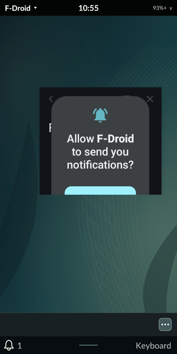

# Android apps through Waydroid

This page records the [M6A](DEVELOPMENT_PLAN.md#m6a-android-applications-as-cards-through-waydroid)
investigation. The plan allows its first two steps (platform audit and window
model) to start before M6; no Tarot code integrates Android yet.

## Platform audit, October 31, 2026

On the development PinePhone Pro, running postmarketOS 26.06 with kernel 7.0.0:

| Requirement | Finding |
| --- | --- |
| Packaging | `waydroid` 1.6.2 with `waydroid-openrc` from the distribution, pulling LXC 7.0.0, libgbinder 1.1.45, gbinder-python and iptables |
| Binder | `CONFIG_ANDROID_BINDER_IPC=y` with fixed `binder`, `hwbinder` and `vndbinder` devices; binderfs is not built, and Waydroid uses the fixed devices |
| Containers | Device cgroups, PSI, memfd, veth, bridge and NAT are available; loop and FUSE load as modules |
| Image | `waydroid init -s VANILLA` fetched LineageOS 20.0 (Android 13), system build 2026-09-27 (912 MB download, 1.99 GB image), and the MAINLINE vendor image 2026-10-22 (148 MB, 422 MB) from Waydroid's OTA channel on SourceForge. VANILLA carries no Google applications |
| Rendering | Hardware accelerated. SurfaceFlinger reports `Mali-T860 MC4 (Panfrost)`, OpenGL ES 3.1 with Mesa 26.0.8; buffers come from minigbm (`gbm_mesa`) on `/dev/dri/renderD128`, and `ro.hardware.vulkan` is `panfrost`. Tarot keeps `card1` (rockchip-drm) for the display |
| Boot | Android reported `sys.boot_completed` about 24 s after the session started |
| Memory | 303 MB in use before; 1,700 MB with Android and one app running (the container cgroup reports 2.8 GB including page cache); 333 MB after stopping it, on a 3.8 GB phone |
| Storage | 2.3 GB of images under `/var/lib/waydroid/images`; 88 GB were free |

Image license and updates: the images are LineageOS builds published by the
Waydroid project, mostly Apache 2.0 and GPL components; a full license
inventory of the image has not been made. They update through the OTA URLs in
`/var/lib/waydroid/waydroid.cfg`, and `waydroid upgrade` applies them. Choosing the
VANILLA type is how a Google-free image is selected. Tarot neither ships nor
modifies the image.

### Networking on postmarketOS

The container got no address at first: Android's DHCP requests went
unanswered. postmarketOS's `inet filter` table drops input and forwarding by
default, and nftables requires every base chain on a hook to accept a packet,
so Waydroid's own accepting `lxc` table is not enough. The fix is the
distribution's `waydroid-nftrules`, but installing it only places
`51_waydroid.nft` in `/usr/share/nftables.avail`. It must be linked into
`/etc/nftables.d`, like `50_sshd.nft`, and nftables reloaded.

A reload flushes the `lxc` tables that Waydroid's network script created, so
NAT stops until the container restarts. After restarting it, Android got
192.168.240.112 and reached the internet (about 14 ms to 1.1.1.1, with DNS).
Tarot's Settings integration must order these steps, or recover the container
after any firewall reload.

### Power behavior

With `suspend_action = freeze` (the default), Android asks the container
manager to suspend when it has nothing on screen, and the whole container is
frozen through `lxc-freeze`. While frozen, `waydroid app install` silently does
nothing and `waydroid prop` thaws it briefly. `waydroid` commands that talk to
the session need the session bus, so tools must run with Tarot's environment.

## Window model

`persist.waydroid.multi_windows` set to `true` gives each Android task its own
Wayland window instead of one full Android screen. F-Droid 1 (APK from
f-droid.org, signature verified against F-Droid's key
`37D2 C987 89D8 3119 4839 4E3E 41E7 044E 1DBA 2E89`) was installed with
`waydroid app install`.

`tests/phone_waydroid_replay.py` checks Tarot's side in a diagnostic session on
signed revision 66, through the frozen native controller. It launches
`waydroid.org.fdroid.fdroid.desktop` from Tarot's catalog with the Waydroid
session stopped, reads Tarot's cards and Android's tasks, closes the card
through Tarot and stops the session again. Three runs; each restored the normal
session exactly and passed an independent normal audit:

| Run | Result |
| --- | --- |
| 1 | A card titled "Waydroid" appeared after 6.5 s. Android was still booting (its only task was `FallbackHome`); the replay read the cards too early. The screenshot shows the LineageOS boot animation inside a Tarot card |
| 2 | Boot card "Waydroid" after 8 s. Android reported the F-Droid task after 52 s, by which time Tarot showed exactly **one card, titled "F-Droid", with app_id `waydroid.org.fdroid.fdroid`**; the boot card was gone. Closing the card in Tarot removed the Android task. Evidence `f8dde1966aa798425a86c38c9bbf924db6e581642d6a5ac2df340b7036eaab8e` (run 2's normal audit initially checked the wrong replay key; a corrected copy outside the frozen payload passed) |
| 3 | Same card behavior (task after 48 s, one "F-Droid" card, closing removes the task), plus geometry: Tarot's surface was the full card, 360×604 logical, while Android ran the task **freeform** at `Rect(162, 292 - 559, 1012)` on a 720×728 display. Evidence `6c396cd17d88e82f7407483b0203af0535f88bf7ff64dae342387b2269b85582` |



What works: one card per Android task with Android's app name as the title,
a temporary "Waydroid" card while Android boots, Android's launcher never
appearing as a card, the permission prompt staying inside its app's card, and
close ending the Android task (`removeTask`, Android's semantics). Rendering is
accelerated.

What does not yet:
- **Apps do not fill their card.** In multi-window mode Android launches tasks
  in freeform mode at its default size, so the app sits small in the middle of
  the card with Android's caption bar, and Tarot's wallpaper shows around it.
  Waydroid's composer ([`wayland-hwc.cpp`](https://github.com/waydroid/android_hardware_waydroid/blob/HEAD/hwcomposer/wayland-hwc.cpp))
  sizes one Android display from its first window and gives every task window
  that size; its task interface offers `setFocusedTask`, `removeTask`,
  `getAppName` and `removeAllVisibleRecentTasks`, but no resize. `am task
  resize <id> 0 0 <w> <h>` inside Android (root) does make the task fill the
  display, and Waydroid's F11 patch toggles freeform and fullscreen. The clean
  fix is upstream: resize a task window's Android task to the size the
  compositor configures, or launch tasks fullscreen on phone-sized displays.
  Sending F11 from Tarot would be a special case and is not planned.
- **The Android display size varies.** Run 3 calibrated to 720×728 and clipped
  the window; outside the diagnostic session the same phone calibrated to
  720×1304. Tarot reported the boot card at the full card size, so the exact
  configure sequence during Waydroid's calibration (including its fallback to
  the output size) still needs tracing.
- Android's app icon is not yet shown on the card, and popups other than the
  permission prompt, fullscreen and the keyboard reservation are untested.

## Launch and catalog, first observations

Waydroid writes one desktop entry per Android app to
`~/.local/share/applications/waydroid.<package>.desktop`, for example:

```
Name=F-Droid
Exec=waydroid app launch org.fdroid.fdroid
Icon=/home/user/.local/share/waydroid/data/icons/org.fdroid.fdroid.png
Categories=X-WayDroid-App;
```

Tarot's launcher reads these like any other entry, from the next compositor
start. `waydroid app launch` starts the Android session itself when none is
running, which is the lazy start the plan asks for, but it needs the root
container manager. That service is enabled on the development phone for this
evaluation (`rc-update add waydroid-container default`); Android itself only
boots on the first launch. Undo with `rc-update del waydroid-container
default`, or remove the packages and `/var/lib/waydroid`.

## Next

1. Trace the configure sequence during Waydroid's display calibration, and
   propose the task-resize change upstream.
2. Measure idle power with the container stopped, frozen and running.
3. Text input (Tarot keyboard or Android IME), Back mapping, lock and suspend
   with the container frozen.
