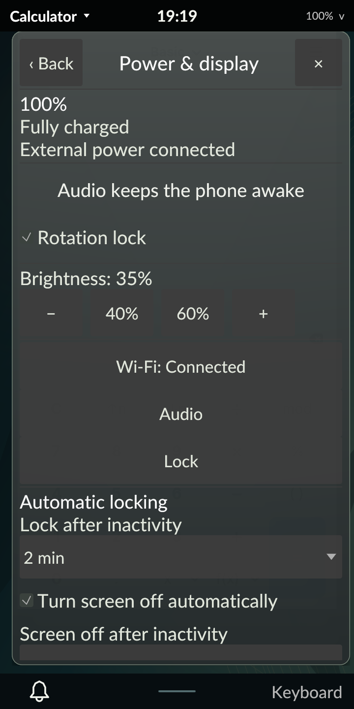

# Audio activity and system sleep on the PinePhone Pro

October 30, 2026. Signed revision 57 holds an ordinary-user sleep-block descriptor
for observed uncorked playback or recording, while automatic lock/display idle
remain independent. The phone defaults to normal Tarot57 with diagnostics off.
This is scoped M4 progress; the full development plan remains active.
[Implementation contract](../../AUDIO_INHIBITION.md).

## Native acceptance

An owned null sink supplies zero-PCM playback and its monitor supplies capture.
The recording fixture discards buffers without inspecting or storing samples.
Neither stream selects a physical audio device. Independent server reads and
Tarot's observed activity agree on corked, playback, combined playback/capture,
capture-only and all-corked states. Actual login1 `ListInhibitors` readback shows
one sleep/block grant with the static audio reason, Tarot's UID 10000 and the
loaded compositor PID. The corresponding process descriptor is close-on-exec.

Capture retains the same grant after playback corks; the last stream releases
it. A separate active-client exit also releases the grant. A temporary fifteen-
second idle policy locks and powers off the panel while playback and its block
remain active. Independent driver readback reports DPMS Off/backlight power 4,
then On/0 after wake. Stopping the last stream while the panel is off removes the
block. Diagnostic status remains redacted during protection. A neutral wake is
consumed before full current locker presentation and actual PAM authentication.

The replay restores idle preferences, closes its clients, verifies module
ID/name/arguments before unloading only its null sink, and restores every
original card mode, input/output channel value, mute, route and default. No test
stream, null device or audio block remains. Canonical protected startup in all
four orientations, native Calculator, actual PAM, clean logout and fresh normal
login pass. Tarot/MIME preferences, feedback settings and user override presence,
policies/rules, NetworkManager profiles/active connection and backlight match
their baseline. NetworkManager and the system bus retain their process/start
identities. An independent audit verifies normal/default Tarot57, all four loaded
hashes, Panfrost, hardware keys, diagnostics/metadata off, normal GUI-owned audio
and feedback providers and absent QA resources.

This proves real manager registration and FD lifetime with protected display
idle. It does not prove kernel suspend rejection attributable solely to Tarot:
the test never calls Suspend, and the distribution also inhibits sleep during
SSH. Actual kernel policy/reliability with other inhibitors absent remains open.

## Host and package acceptance

Rust 1.98.1 and minimum 1.89.0 each pass 275 workspace tests, with nine explicitly
ignored. Strict owned-code host/AArch64-musl DRM lint passes. Both frozen binaries
pass real private audio-inhibition, existing audio-control and feedback matrices.
The inhibition matrix covers corking, capture-only retention, one combined grant,
late grant retirement, denial, timeout with a late FD, manager/broker replacement,
audio-server loss/recovery, automatic lock/redaction and pending logout cleanup.
It never selects physical audio or calls Suspend.

The existing protected sleep-delay replay passes its FD/presentation/spoof/
resume/rearm/recovery cases. Both frozen builds pass shared-transport regressions
for authentication cancellation, a full listener backlog and fragmented big-
endian oversized frames. The transport moved to `tarot::local_bus` so the audio
worker reuses bounded setup, cancellation and frame/FD limits. Typed stream
callback tests cover corked/muted states, ignored metadata and bounded inventory.
A rendered test proves awake-status changes leave Power controls stationary.

The canonical clean Alpine cross-build exits 0 using 446 verified locked registry
packages. All 469 compiler inputs match its source archive. The package audit
verifies AArch64 executables, unchanged dependencies/PAM/session entry and absent
installation scripts. Signature verification and a Tarot-only offline upgrade
pass on the first native attempt. The accepted retry uses the same installed
package. Target unit tests are not executed by abuild. Later native-only QA and
final documentation have separate ledgers.

| Artifact | SHA-256 |
| --- | --- |
| Canonical source archive | `18ec9e0d820b1844a12e2e33cefc324564865d757e64e38e213809263520783f` |
| Signed revision-57 APK | `9287b6d723209e9cdd8fc2eca0436de79ca7d008703b7d862eb00b2601059753` |
| Accepted native archive | `e1f341a94dce2d6df13bc5488fcde3d212ef8d1f02efd22915ec4058e38b3aa8` |

All 645 accepted members and 630 frozen inputs verify. Full private reports,
source/binary ledgers, candidate builds and failed checks remain under ignored
`artifacts/m4/audio-inhibit/`. Device originals remain in
`/home/user/tarot-dev/audio-inhibit-r57` and `audio-inhibit-r57-check2`; the latter
is accepted. The public [evidence index](evidence.json) records the boundaries.

## Retained failures and limits

The first native run passes real grant/stream/display-off cases, then its shared
QA authentication helper waits for a locker buffer while the intentionally black
off frame is current. The corrected helper wakes from verified protection and
still requires full current locker presentation, stable portrait and actual PAM
before entry. The failed run restores exact original settings and normal
Tarot57, with independent audit. All 649 members/630 inputs verify, archive hash
`3c72f3f7945e7f1a2a6bca672f9e37e05c7b0da857913a16fcccea015db5e173`.
No runtime change or package reinstall separates the native attempts.

The first package candidate is withheld after a rendered check reproduces Power
controls moving when audio status appears. Its APK hash is
`efd569e8e9d2e6c0663c9aa45cc5cf9eecd956dea96c04a9015958e97c1b3aba`.
A fixed-height status row resolves the layout; that next uninstalled candidate
is superseded to include the final test-fixture correction in canonical source.
Neither earlier candidate was installed.

The recurring URI test failure reports ETXTBSY (26), not a URI argument or shell-
quoting failure. A controlled child retains a writer lease after the parent
closes its own copy; execution succeeds after that child execs. The test now
publishes its helper in an owned child, preventing concurrent forks of the test
process from inheriting its writer. Forty full process suites and both complete
workspace suites pass afterward; no production URI retry or behavior changed.
The diagnostic instrumentation is removed, and original failures remain retained.
Early private QA also corrects the synthetic lock handshake, the stream-drop
symbol and a nested test that incorrectly requested DRM-only panel power-off.

Acoustic output/capture, Bluetooth, calls, direct ALSA/independent-server policy,
MPRIS controls, broader work inhibitors, accessibility and power/performance/
endurance remain open. Audio observation loss releases Tarot's audio block;
uncorked but starved streams can keep it held. Physical Bluetooth tests remain
deferred at the owner's request. No kernel cycle, whole milestone or release
completion is claimed.
