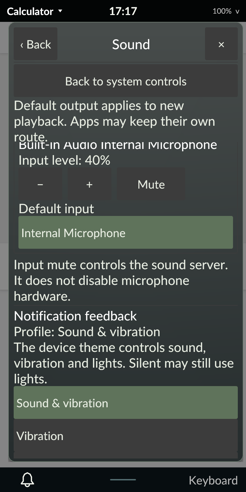

# Recording inputs and routes on the PinePhone Pro

October 30, 2026. Signed revision 55 adds recording-input controls and observed
input/output routes. The phone defaults to normal Tarot55 with diagnostics off.
This is scoped M4 progress; the full development plan remains active.
[Implementation contract](../../AUDIO_INPUTS.md).

## Native acceptance

The phone exposes one ordinary recording input, one playback-monitor source and
one route per physical input/output. Tarot excludes the monitor from the input
chooser. Actual rendered touches changed the microphone level from 40% to 50%
and back to 40%, then muted and unmuted it. Independent ordinary-user `pactl`
reads matched each observed completion. Selecting the already active microphone
route through its painted button also completed without leaving pending state.
The existing speaker route was reselected through the adapter and independently
read back; this run does not claim a physical multi-route switch.

A temporary, uniquely named null source supplied a second input. Actual rendered
“Use for new recordings” controls selected it as default, then restored the real
microphone as default. Independent server reads matched both changes. The test
verified its module ID/name/arguments before removing it. Tarot removed the old
row, and a stale action for that input was rejected. No recording or playback
stream was opened; this is control/readback evidence, not acoustic acceptance.

Locking redacted diagnostic status and rejected input-mute and route commands.
Actual PAM unlocked the session. Protected startup in all four orientations,
a native Calculator card, available audio service, clean logout and a fresh
normal login also passed. No suspend cycle or Bluetooth peer test was requested.

Exact original source channel values, mute, routes and default input were
restored, including the monitor's saved controls. Output channel values, mute,
route and default output remained unchanged. Original Tarot/MIME preferences,
feedback GSettings values and user override presence, policies/rules,
NetworkManager profiles/active connection and backlight matched their baseline.
NetworkManager and the system bus retained their original process/start identity.
An independent audit verifies actual normal/default Tarot, all four loaded
executable hashes, Panfrost, services, hardware keys, diagnostics/metadata off,
no synthetic input/recording client and no remaining diagnostic cgroup/socket or
virtual input device.

## Host and package acceptance

Rust 1.98.1 and minimum 1.89.0 each pass 267 workspace tests, with nine explicitly
ignored. Strict host and AArch64-musl/DRM lint pass. Both frozen compiler binaries
pass the real private-server audio matrix and the private feedback lifecycle/
recovery matrix. Audio tests own their broker, PulseAudio daemon, X display and
synthetic sources/sinks, and open no recording/playback stream.

The matrix covers channel balance, zero and same-value completion, mute/default
readback, playback-monitor exclusion, direction/unknown-route rejection,
hotplug/re-add, stale identities, delayed input replies, output timeout/recovery,
daemon replacement, stale input epochs and pending-input shutdown near 0.12
seconds. Typed callback tests cover copied strings/ports and invalid arrays;
model/UI tests cover route availability, input identities and coalesced removal.
A focused rendered test proves that service updates preserve a scrolled position
while retiring a held route choice; a fresh contact still activates that route.

The clean Alpine cross-build completed with exit 0 from 446 checksum-verified
locked registry packages. The package audit verifies AArch64 binaries, unchanged
dependencies/PAM/session entry and no installation scripts. Only the four
programs and packaged README changed. Signed verification and a Tarot-only
offline upgrade passed on the first native attempt. The subsequent accepted run
used the unchanged installed package without reinstalling it. Target unit tests
were not executed by abuild. Compiler inputs match the fixed source archive;
later native QA and final documentation have separate frozen records.

| Artifact | SHA-256 |
| --- | --- |
| Corrected source archive | `0efc29db47f1307e28da2df2756998234ee9d70770a29384b2f471f2ce221de4` |
| Signed revision-55 APK | `ac60a3d2c42368fd76f116f1b9fa70a1a4240652121be9911931620b6fdc5d7e` |
| Accepted native archive | `a63bbcab3c042565b6e55f04947de040cb07ae67a5dd1a1793d9460841495150` |

All 653 accepted archive members and 623 frozen inputs verify. Full reports,
failed attempts, source/binary ledgers and package audits remain under ignored
`artifacts/m4/audio-routing/`. Device originals are retained in
`/home/user/tarot-dev/audio-routing-r55`, `audio-routing-r55-retry` and
`audio-routing-r55-check3`; the last is the accepted run. The public
[evidence index](evidence.json) records hashes and acceptance boundaries.

## Retained failures and remaining gates

The first private attempt supplied an unsupported null-source argument; the
installed module's usage string identified `description=` as the supported
option. Running two compiler checks together then exposed incomplete fixture
D-Bus isolation: its private audio sockets inherited the desktop bus and competed
for a service name. The corrected fixture gives each run its own broker; both
final matrices pass with complete owned endpoints.

Expanding Sound exposed a real scroll defect. Service-generation IDs surrounded
the scroll area, so an update reset its position and a later click could hit a
different control. An earlier QA match on “Silent” in explanatory text first hid
the issue. Whole-button matching and real scrolling reproduced it. The fix keeps
scroll state stable and puts audio/feedback generations on interactive groups.
The original failures, passing focused test and final rendered matrices remain
retained. The first signed candidate, hash
`a0cbab67f2fbe79eb23c0498aefeda279499ae0330a81c388e1831f43b0606bf`,
was withheld and never installed.

The first native attempt passed level/mute checks, then its original OCR missed
the selected green route label. Contrast recognition fixes that QA path. The
second attempt passed route/default controls, then its cleanup guard assumed
module JSON included IDs; this phone's `pactl` omits them. ID-bearing short output
now verifies module ownership in both normal and failure cleanup. Each failed
attempt returned to normal Tarot55 with independent exact-restoration audits.
The third attempt passes the complete component on the same APK. Both failure
archives and their 623-input manifests verify independently.

Acoustic quality, real microphone capture, simultaneous app recordings, multiple
physical routes/jack hotplug, card profiles, per-app routing, PipeWire runtime,
call policy, accessibility and power/performance/endurance remain open. Touch
drags can select explanatory label text; refine that with the broader phone
interaction work. Bluetooth remains deferred at the owner's request. No whole
milestone, DMP gesture or release readiness is claimed.
