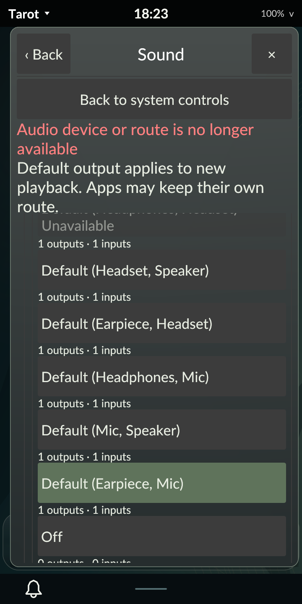

# Audio device modes and menu touch behavior

October 30, 2026. Signed revision 56 adds explicit audio-card mode selection and
prevents explanatory shell menu labels from selecting text during finger drags.
That checkpoint verifies normal Tarot56 with diagnostics off. This is scoped M4
progress; the full development plan remains active.
[Implementation contract](../../AUDIO_MODES.md).

The later [revision-57 checkpoint](../audio-inhibit/README.md) adds observed audio
sleep-block ownership with independent lock/display idle; its limits and native
acceptance are recorded separately.

## Native acceptance

The PinePhone Pro exposes one rt5640 card with thirteen UCM modes, including two
unavailable modes. Actual rendered touches select Default (Earpiece, Mic), Off
and Default (Mic, Speaker); independent ordinary-user server reads verify each
change. A same-value request clears its reservation. An unavailable mode is
rejected without changing the card.

Off declares zero card inputs/outputs and removes the physical endpoints. This
OS creates an `auto_null` dummy output and its monitor; Tarot reports that output
and excludes the monitor from recording inputs. The mode selector remains usable
and restores the physical microphone/speaker. Old endpoint actions are rejected.
The test preserves the distribution's fallback policy.

A five-second resume watchdog is armed before pausing the verified idle user
audio server through a bound process descriptor. Tarot reports pending state,
remains responsive to Home, times out, reconnects with new identities and rejects
the old card command. The same actual server resumes; this is distinct from the
next check, which gracefully stops it and starts a fresh standard user server.
The selected Earpiece mode survives that replacement without QA injecting a mode
before measurement. Old server identities remain unusable.

Locking redacts diagnostic status and rejects profile commands. Actual PAM
unlocks the session. The selected Earpiece mode then survives clean logout,
termination of the diagnostic audio server and fresh normal login with another
user server. Only after observing persistence does the controller restore the
original Speaker mode and every original input/output channel value, mute,
route and default. Tarot stores no duplicate card-mode preference.

A horizontal touch drag over the input-mute explanation produces zero selected
green pixels in its glyph bounds. This complements the rendered regression that
reproduces the old selection and checks editable-field selection/copy still work.
The change is scoped to shell menu labels; native clients own their text behavior.

Canonical protected startup in all four orientations, native Calculator, actual
PAM, clean logout and fresh normal login pass. Original Tarot/MIME preferences,
feedback settings and user override presence, policies/rules, NetworkManager
profiles/active connection and backlight match their baseline. NetworkManager
and the system bus retain their process/start identities. Independent normal
audit verifies default Tarot56, all four loaded hashes, Panfrost, hardware keys,
diagnostics/metadata off, one ordinary-user audio server in the GUI session,
no watchdog or diagnostic input/socket/cgroup, and no recording client.

## Host and package acceptance

Rust 1.98.1 and minimum 1.89.0 each pass 273 workspace tests, with nine explicitly
ignored. Strict owned-code host/AArch64-musl DRM lint and both frozen-binary
private audio and feedback matrices pass. Typed callback tests cover the modern
availability boolean, copied data and invalid bounds; model/UI tests cover
parent identity, unavailable/pending modes, empty endpoints, card/child re-add,
held-choice retirement and scoped label behavior. The private real audio server
has synthetic endpoints without cards: positive profile writes are established
by the native checks, rather than claimed from that host fixture.

The clean Alpine cross-build exits 0 using 446 verified locked registry packages.
The package audit verifies AArch64 executables, unchanged dependencies/PAM/session
entry and absent installation scripts. Signature verification and a Tarot-only
offline upgrade pass on the first native attempt. The accepted retry keeps the
same package installed. Target unit tests are not executed by abuild. Compiler
inputs match the source archive; later native-only QA and final documentation
have separate ledgers.

| Artifact | SHA-256 |
| --- | --- |
| Source archive | `5b9654e42be3d7ff5fcff5d8ebaf46b70ca1a8ea2de2be602576cb00ee5f925c` |
| Signed revision-56 APK | `cd5537739e047ab7f3d3cf1b4b404a611d53f55cb95ce22b7cc55e7143c2bad1` |
| Accepted native archive | `9c15d1f23b580ae5e577b6384f4a0d3033c5c22c69065ceabcd30afd3a3acdb3` |

All 671 accepted archive members and 626 frozen inputs verify. Complete private
reports, ledgers and the failed attempt remain under ignored
`artifacts/m4/audio-profiles/`. Device originals remain in
`/home/user/tarot-dev/audio-profiles-r56` and `audio-profiles-r56-check2`; the latter
is accepted. The public [evidence index](evidence.json) records the boundaries.

## Retained failure and remaining gates

The first native attempt passes Earpiece and Off selection, then fails a QA
assertion expecting the global endpoint lists to be empty. Off correctly leaves
the distribution's dummy output. The corrected check verifies the selected card,
absence of physical endpoints, exact dummy driver/name and monitor exclusion.
It does not unload the fallback module. The original failed result and
independent exact-restoration audit verify across 667 members/626 frozen inputs,
archive hash `61393e3d1ce3ef16f7f3ebad75400d17ce3907dfe764869d07121baa7ab85ad9`.
No runtime change or package reinstall separates the attempts.

These controls establish neither acoustic output nor microphone capture quality.
Call-named UCM entries do not prove calls. Bluetooth modes, multiple physical
cards/routes, jack hotplug, per-app routing, PipeWire runtime, automatic call/
media policy, accessibility, power/performance and endurance remain open.
Physical Bluetooth tests stay deferred at the owner's request. No stream, tone,
call, suspend cycle, whole milestone or release acceptance is claimed.
