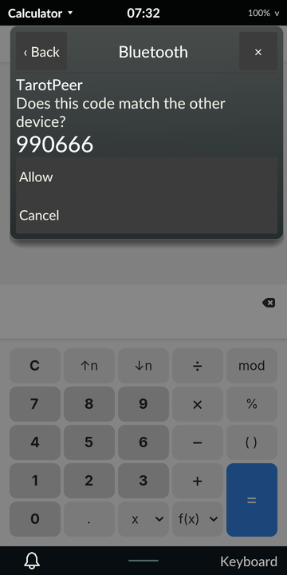

# Bluetooth with a real test peer

October 31, 2026. The owner provided a Plugable USB Bluetooth 4.0 adapter
(Broadcom BCM20702A0) on the development host as a dedicated test peer.
**Tarot now pairs with it by touch end to end**: discovery, numeric
comparison, trust, connect, disconnect and Forget, with every step read back
from BlueZ. The first run's "controller blocker" turned out to be mostly
distance, plus an intermittent problem with the phone's incoming connections,
described below.

## Test setup

`tests/bluetooth_peer.py` runs on the host and uses only the adapter it is
given (`5C:F3:70:8C:89:6B`):
- It sets a test alias, `TarotPeer`, and makes the adapter visible and pairable.
- It registers a DisplayYesNo agent that records and accepts numeric-comparison
  codes.
- On exit it removes any pairing with the phone and restores every adapter
  property it changed. An alias equal to the system name is restored as
  BlueZ's default (empty), so no explicit alias is left stored.
- BlueZ's default-agent stack returns the desktop's own agent afterwards.

`tests/phone_bluetooth_pair_replay.py` runs inside a diagnostic Tarot session
on the phone. It drives the Bluetooth page by touch, with targets found by OCR:
Find devices, select the peer, Pair, confirm the six-digit code, Trust,
Connect/Disconnect, and the two-step Forget. Each step is read back
independently from BlueZ by the peer's address. After the run it reads the
code Tarot displayed so it can be compared with the peer's.

Two diagnostics check the reverse direction, other devices reaching the phone:
- `tests/phone_bluetooth_visible.py` runs on the phone. It makes the adapter
  visible for a bounded time, then restores both visibility properties exactly.
- `tests/bluetooth_reachability.py` runs on the host. Each round, every given
  adapter runs a short classic discovery and reports the phone's signal
  strength. One adapter then pages the phone. A temporary agent rejects all
  requests meanwhile, so no pairing prompt reaches the desktop. A page timeout
  means the phone never answered. An authentication refusal means the page
  reached the phone, which declined because it is unpaired.

## First run: failure (signed revision 64)

Tarot found and selected the peer, but pairing failed with `Page Timeout`.
Calling BlueZ directly on the phone failed the same way. The phone heard the
peer at −72 dBm, and no host radio could find the phone while it was visible.
A firmware or clock mismatch in the phone's Bluetooth controller was
suspected. Tarot reported the failure and left no pairing or visibility
behind. Evidence: `artifacts/m4/bluetooth-peer/phone/` (proof
`d110f77bbf8d71c965ea894fc1f6c019fdff0059d314cad239b7d00f350357d3`).

## Investigation

The phone's controller is a BCM4345C0 in the AzureWave AW-CM256SM module. It
sits on UART `ff180000` (`hci_uart_bcm`) and shares one antenna with the
module's Wi-Fi. The investigation found:

- **Distance caused the outgoing failures.** With the phone moved close to the
  peer (−52 dBm instead of −72), BlueZ on the phone found and paired with the
  peer 6 times out of 6, and the codes matched the peer's each time.
- **For a time, nothing could reach the phone, even at close range.** Neither
  the Plugable nor the host's Intel radio could discover the visible phone, and
  pages timed out. A phone-side trace showed the scan settings accepted and
  not a single incoming connection request. Blocking the phone's Wi-Fi with
  `rfkill` made the phone discoverable and pageable at once, so Wi-Fi/Bluetooth
  coexistence on the shared antenna was starving Bluetooth's scan windows.
- **Reloading the Wi-Fi driver cleared it.** After `brcmfmac` reloaded, both
  host radios found the phone and every page reached it. This held with and
  without the Raspberry Pi coexistence settings (`btc_mode=1` and parameters)
  added to the Wi-Fi config file (NVRAM), so the reload was what mattered.
- **The bad state could not be reproduced.** None of these brought it back: a
  reboot, an hour of uptime (the Plugable found the phone in 16 of 16 checks,
  the Intel radio in 12), a Bluetooth power cycle, a Wi-Fi reload with the
  radio off, or Wi-Fi starting while Bluetooth ran a different patch. The
  previous boot's log shows no suspend, roaming or channel change. What
  triggered it is still unknown.

Ruled out along the way:
- **Patch firmware:** the distribution's patch (`BCM4345C0.hcd`, build 0382),
  Armbian's `BCM4345C0.hcd` (build 0230) and the bare ROM behave the same.
- **32 kHz sleep clock:** PMIC register `0x20` reads `0x01`, which selects the
  clock function and enables it. The clock reports 32768 Hz and is enabled.
  This is the fault the pending upstream `clk-rk808` patches address for
  other kernels.
- **UART flow control:** RTS is asserted whenever the controller is awake. It
  drops only during runtime suspend, as `hci_bcm` intends.
- **Controller and Wi-Fi power saving:** disabling the controller's sleep mode
  or Wi-Fi power save changed nothing.

No kernel, device-tree or firmware change was needed, so nothing was sent
upstream. If the incoming problem returns, reloading `brcmfmac` is the known
recovery, and the reachability check above shows whether it is needed.

## Second run: pass (signed revision 64, close range)

With the phone near the peer, the same replay passed every step:

1. Find devices discovered `TarotPeer`, and a touch on its row selected it.
2. Pair showed a numeric-comparison prompt. OCR read `990666` from Tarot's
   screen, and the peer's agent recorded the same code. Allow was tapped, and
   BlueZ showed the device paired and bonded. Tarot never turned the phone's
   own visibility on.
3. Trust was set, and Connect and Disconnect both completed. The peer
   authorized the phone's audio and remote-control services.
4. The two-step Forget removed the device.

The controller restored the normal Tarot session, the baseline, controls,
preferences and fixtures exactly, with no package reinstall. An independent
normal-session audit passed. The host peer removed its pairing and restored
the adapter exactly. A preceding attempt stopped at its first precondition
because the phone was at the login screen after a reboot; it changed nothing
and is kept in the evidence as `native-proof-no-session`.

The reachability check, run afterwards over three rounds, found the phone in
every round with the Plugable (−61 to −62 dBm) and in two with the Intel
radio. Each page reached the phone and was refused in 1–2 seconds.

Evidence: `artifacts/m4/bluetooth-peer/phone2/proof.tar.gz` (SHA-256
`1bdf99efda123b0f4e95980b48951b05b5304232b3ca3f17b3294e3fd3f582f4`, 688
members, 654 frozen inputs), the host peer report `run2.jsonl`, and
`reachability.jsonl` with `reachability-visible.jsonl`.

## Still open

- **Audio:** done with the owner's headset at close range; see the
  [headset check](../bluetooth-headset/README.md).
- **Incoming trigger:** what puts coexistence into the state that blocks
  incoming connections.
- **Range:** classic Bluetooth range at the phone's −72 dBm spot was poor in
  both directions. Whether that is expected for this antenna is unmeasured.
