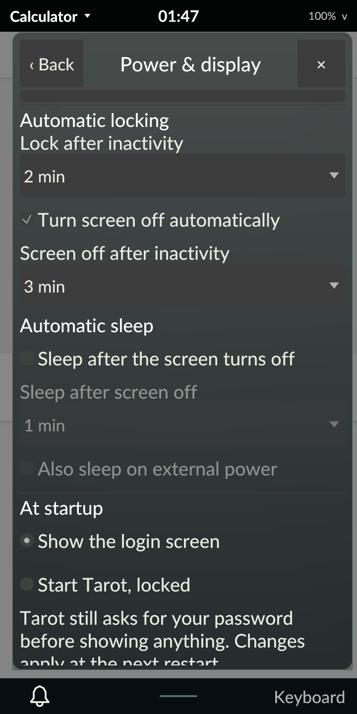
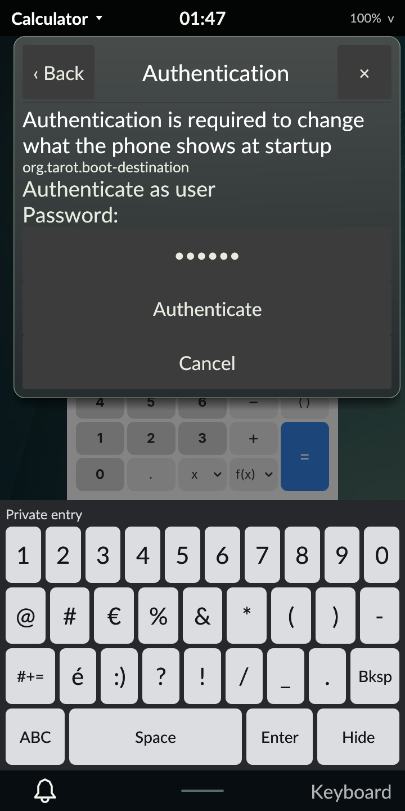

# Boot destination: greeter or direct Tarot

October 30, 2026. Signed revision 62 implements the owner-requested
[boot destination setting](../../DEVELOPMENT_PLAN.md#m4-addition-boot-destination-setting).
The Power page's **At startup** section chooses **Show the login screen**
(Phrog) or **Start Tarot, locked**. Direct boot opens the owner's Tarot session
at power-on, and Tarot still requires actual PAM before showing content. The
default stays the login screen.

## How it works

- **Configuration.** greetd picks its configuration through `cfgfile=` in
  `/etc/conf.d/greetd`. Direct boot writes `/etc/tarot/greetd-direct.toml`
  from the current greeter configuration, adding:
  - the greeter's `[terminal]` and `[default_session]`, unchanged
  - `[general] service = "tarot-greetd"`
  - `[initial_session]` running `/usr/bin/tarot-session` for the invoking user

  The original `cfgfile` value is recorded in `/etc/tarot/boot-destination`
  before only that line is switched. Switching back restores the line exactly
  and removes both files.
- **Fallback.** greetd 0.10.3 runs an initial session once per boot. Logging
  out, or the session ending, returns to the greeter, and Phosh stays available
  from there.
- **Session type.** greetd 0.10.3 opens an initial session with an empty
  environment, and it ignores a per-initial-session PAM service. Without
  `XDG_SESSION_TYPE`, login1 would register a non-Wayland session, and
  `tarot-session` correctly refuses that. The packaged `tarot-greetd` PAM
  service therefore runs `pam_env` before `base-session` with
  `XDG_SESSION_TYPE DEFAULT=wayland OVERRIDE=${XDG_SESSION_TYPE}`. Linux-PAM
  1.7.1 reads the override through `pam_getenv`, so a greeter-provided type
  is kept.
- **Why not `SetType`.** login1's `Session.SetType` can't help, because elogind
  resets the type when control is dropped. Phrog-started sessions keep normal
  password authentication through `base-auth`.
- **Privilege.** Changes run `/usr/libexec/tarot-boot-destination set
  tarot|greeter` through `pkexec`. The Polkit action
  `org.tarot.boot-destination` requires administrator authentication for
  active local sessions and denies inactive and remote ones. The helper derives
  the account from `PKEXEC_UID`, never root, and validates names and paths.
  Files are replaced atomically with the original mode and owner, and the
  helper returns the reread state. Reading the setting is unprivileged.
- **Shell.** A worker reads the state and runs `pkexec` off the compositor
  thread; Tarot's Polkit agent shows the prompt. The radio reflects the file
  on disk; a choice shows as pending until the file is reread. Denial and
  timeout appear as explicit errors. Nested sessions never show the section.

## Native acceptance

`tests/phone_boot_destination.py` ran in three reboot-separated phases on the
installed signed r62.

1. **select:**
   - an ordinary process in the inactive SSH session is refused by
     Polkit (`pkexec` 127, "Not authorized"), with the file unchanged
   - root without `PKEXEC_UID` is refused, as is a root target
   - the helper selects direct boot for `user`, and only the `cfgfile` line
     changes, keeping mode and owner
2. **direct (new boot):**
   - Tarot, its locker and keyboard run as `user`, and no Phrog starts
   - login1 reports Wayland type, user class, active, local, VT7, seat0 and
     service `tarot-greetd`
   - ending the verified compositor brings Phrog back, and the initial session
     does not repeat
   - the helper restores the greeter, and the original file hash matches
3. **final (new boot):** Phrog greets with the original configuration and no
   managed files. A normal greetd/PAM login then restores Tarot62.

Rust 1.98.1 and minimum 1.89.0 each pass 294 workspace tests, including the
following new tests:
- helper round trip, unsafe inputs, missing-original and account resolution
- single-request model behavior
- a rendered Power-page test of observed state, a single request, pending
  lockout and error text

Owned-code strict Clippy passes. The r62 package audit allows only the helper,
Polkit action, PAM service and `pam_env` file as additions, each matching the
repository.

| Artifact | SHA-256 |
| --- | --- |
| Canonical source archive | `33332882726407389004a796b41a68bd3d2a801df4b536199a12e40730a858d2` |
| Signed APK `tarot-0.1.0-r62.apk` | `c238a0ded4ba26669223084a512de4b4e07938691375083ef73db1eb85b35ad4` |
| Original `/etc/conf.d/greetd` | `6523d36fa3490b4f518184bb0d5a1dd025f14e93ead2b0f9a80f82d685a953f0` |
| Phase record | `b5d057406cae775f6ca3dcbdc403f66607785a1b6119e998694d5f77fabe7f99` |

## Finger and Polkit-agent acceptance

A separate native run on the same signed r62 used a diagnostic Tarot session and
real touch input. Its targets were found by OCR on the rendered page:

1. On the Power page, tapping **Start Tarot, locked** ran pkexec. Tarot's own
   Polkit agent showed the action's message and "Authenticate as user". The
   real administrator password was typed on the private on-screen keyboard and
   submitted with **Authenticate**. The page then reported Tarot from the reread
   file, with no error, and the managed configuration was in place.
2. Tapping **Show the login screen**, then **Cancel** at the prompt, reported
   "Not changed: authorization was not given". The file stayed byte-identical.
3. Tapping **Show the login screen** again with the real password restored the
   original `/etc/conf.d/greetd` hash and removed the managed files.

The controller restored preferences and controls exactly and logged normal
Tarot62 back in. An independent audit passed. Evidence archive:
`108c43d1ca3ff60efe22a9cea09c40f8b7489995c3d7cb88d6a13a6aebbd347d` (676 members).

## Keyring and encrypted storage

This image has no disk or home encryption: there is no crypttab and no dm-crypt
device. It does run gnome-keyring, and Nura's `base-auth` stack includes
`-auth optional pam_gnome_keyring.so`. Direct boot enters no password at login,
so the `login` keyring can start locked.

A native run on signed r62 tested the unlock path:
1. In a diagnostic Tarot session, the `login` collection was locked through
   Secret Service `Lock`, which needs no prompt, and read back as `Locked`.
2. Tarot was locked and then unlocked with the real password by touch.
3. The collection then read unlocked.

Tarot's locker service includes `base-auth`, so its first unlock opens the
keyring. Direct boot already requires that unlock before showing any content,
so no extra step is needed. The test ran in a greetd-authenticated session; the
direct-boot session uses the same locker stack. Evidence archive:
`8757a96fa673db546761a11a05583742d87803d7738b31f84c617d55a7c36ca8`.

A first observation (archive
`4605a181c00fb2d39b4103f61735a7d06af1d74cd86d3e26f79c63ac524cc447`) began
with the keyring already unlocked by the greetd login, so it did not exercise
this path. It is retained. An earlier read-only probe found a locked keyring
answering on Tarot's private bus from a different daemon instance than the one
PAM started. How the keyring daemon starts relative to Tarot's private session
bus is worth a separate check.

## Limits

- **Diagnostics were off** during direct boot, so this run did not read
  Tarot's lock status. Protected startup and actual PAM before content rely on
  the unchanged installed compositor command, which earlier revisions
  qualified, not on a new measurement here.
- **No single combined run.** The finger path and the reboot phases passed
  in separate runs; they have not been combined into one finger-to-reboot run.
- **Package removal.** Removing the package while direct boot is selected
  would leave greetd pointing at a configuration whose PAM service no longer
  exists. Switch back to the login screen before removing Tarot. A guarded
  removal path remains open, because the package deliberately has no install
  scripts.
- **Stale switch.** A greetd or Phrog update that changes the greeter
  configuration while direct boot is selected takes effect only after
  switching again.
