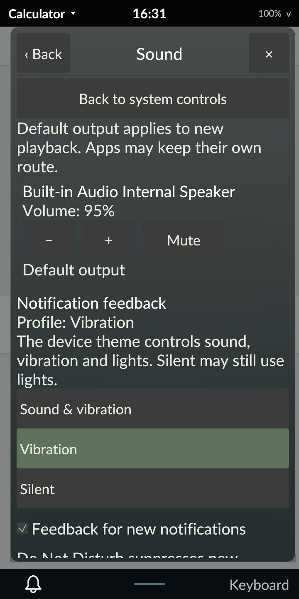

# Feedback profiles on the PinePhone Pro

October 30, 2026. Signed revision 54 adds Rust-owned feedbackd integration to
Sound settings and notification lifecycle. The phone defaults to normal Tarot54
with diagnostics off. This is scoped M4 progress; the full plan remains active.
[Behavior and service contract](../../FEEDBACK.md).

## Native acceptance

Actual rendered touch targets selected Silent, Vibration and Sound & vibration.
Independent ordinary-user GSettings reads matched each selection. The test button
always caps its event at Quiet, including when the global profile is Full.
The installed default and PinePhone Pro themes were checked first: the Quiet
button event contains vibration only, and Silent has no button event. User theme
overrides were absent. No audio playback, Bluetooth peer test or flashlight
request was made.

| Test | Daemon observation | GPIO-vibrator kernel observation |
| --- | --- | --- |
| Silent | No-feedback result shown as unavailable | No upload or event write |
| Vibration | Single-play event ended | One successful force-feedback upload; two complete 24-byte event writes |
| Sound & vibration, test capped at Quiet | Single-play event ended | One successful force-feedback upload; two complete 24-byte event writes |

The standard feedbackd 0.8.9-r2 exporter belonged to UID 10000 in the actual
Tarot login cgroup. It already held the GPIO vibrator's force-feedback descriptor;
normal user groups and existing udev rules supplied access. A root-owned QA
observer used a private tracefs instance filtered to the verified daemon's
threads and raw ioctl/write syscall IDs. Raw events record numeric arguments
without dereferencing buffers. Results retain device descriptor, command, count
and return code. The instance was removed before daemon termination, and global
tracing configuration remained unchanged. These return codes establish kernel
acceptance of device requests, not felt vibration or acoustic quality.

With no active events, the controller revalidated process/start, executable hash,
UID and cgroup, then used a pidfd to terminate only that login's feedback daemon.
Tarot recovered through normal service activation with a new owner/epoch and the
persisted Silent profile. A stale profile command was rejected without changing
the daemon. Existing greeter-owned feedback processes were left untouched.

The notification-feedback checkbox was toggled both ways through rendered
controls and verified in schema-5 preferences. Locking denied profile/test
commands and redacted diagnostic status. Actual PAM unlocked the session without
reopening the settings menu. Protected startup in all four orientations, a
native Calculator card, available audio service, clean logout and a fresh normal
login also passed. No suspend cycle was requested.

Original Tarot/MIME preferences and their metadata, policy/rule files,
NetworkManager profiles and active Wi-Fi identity, audio controls and backlight
matched their baseline. All feedback GSettings effective values and user override
presence were restored logically; no live binary dconf database was copied.
NetworkManager and the system bus retained their original process/start identity.
An independent audit verifies normal default Tarot, all four loaded executable
hashes, Panfrost, services, hardware keys, diagnostics/metadata off, a single
ordinary-user feedback exporter and no leftover input/observer/trace instance.

## Host and package acceptance

Rust 1.98.1 and minimum 1.89.0 each pass all 261 workspace tests, with nine
explicitly ignored. Strict host and AArch64-musl/DRM lint pass. Both frozen
compiler builds pass the rendered private-bus feedback matrix, including
readback/timeouts, unavailable/unknown results, suppression, DND, replacement,
delayed replies, lock, sender loss, daemon/broker replacement, rapid same-owner
release/reacquire with reused IDs and recovery without replay. Sixty-four hung
cancellations share one deadline near 3.03 seconds; unresponsive-peer shutdown
completes near 1.07 seconds. Existing notification, launcher, display and Wi-Fi
authorization regressions pass. Private fixtures drive no hardware.

The clean Alpine cross-build completed with exit 0 from an archive containing
446 checksum-verified locked registry packages. The package audit verifies
AArch64 binaries, unchanged PAM/session entry and no installation scripts.
Only the four programs and packaged README changed. Explicit feedbackd,
feedbackd-udev and feedbackd-device-themes dependencies were added; they were
already installed on this phone. Signed package verification and a Tarot-only
offline transaction passed. Target unit tests were not executed by abuild.
Compiler inputs match the frozen source manifest; native QA and final acceptance
documentation are recorded separately from the earlier source archive.

| Artifact | SHA-256 |
| --- | --- |
| Source archive | `2ea366a986dfa1604b5917c4bc8b6943dc158eb6b3b2eed3b05eec204a2dd431` |
| Signed revision-54 APK | `b492a4480718dea7bd81be6ee474d2ad291fb9ce561dfcc6146d94d9da4622b7` |
| Native evidence archive | `b3bb9296328e8f8807bee65b08c1b3c1b58939e4859f3df89e3d84e5a32c510d` |

All 673 archive members and 621 frozen inputs verify. Full reports and source/
binary ledgers remain under ignored `artifacts/m4/feedback/`; device originals
remain in `/home/user/tarot-dev/feedback-r54`. The public [evidence index](evidence.json)
records hashes, return codes and acceptance boundaries.

## Retained failures and limits

Private-03 exposed a stuck pending indicator when selecting an already active
profile. Publishing the pending transition before the method call corrects it;
the expanded current/minimum final replays pass. Exact upstream 0.8.9 source
review also established that positive timeouts repeat events. Requests were
corrected to `-1` single-play before any native actuation.

An initial observer smoke test found kernel-formatted write events copying
buffer data. It used only an owned pipe containing synthetic `x`; no haptic or
private buffer was observed. The raw-syscall replacement passes its owned-pipe
smoke and native tests. The first native controller attempt failed because its
root-only staging directory prevented the user helper from traversing it. That
attempt made no package or feedback-setting change and returned through normal
PAM; its failure/restoration report is retained. Correcting staging traversal
allowed the accepted run. Initial/final binary comparisons also retain the
artifact-order ambiguity caused by Cargo tests replacing a desktop executable;
final normal rebuilds and replays use the exact frozen delivery hashes. Stopping
the idle builder required SIGKILL after its successful build had completed.

Felt vibration, acoustic quality, notification-specific native physical output,
broader device-theme/per-app policy, accessibility, power/performance and
endurance remain open. Bluetooth tests remain deferred at the owner's request.
No whole milestone, DMP double-chop feature or release readiness is claimed.
