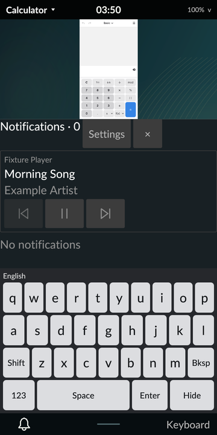

# Media controls (MPRIS)

October 31, 2026. Signed revision 64 shows the current media player in the
notification dashboard, with Previous, Play/Pause and Next. It works with any
application that exports the standard
[MPRIS D-Bus interface](https://specifications.freedesktop.org/mpris-spec/latest/);
no Tarot-specific SDK is involved. This is scoped M4 progress.

## Behavior

- **Discovery.** A worker on the session bus finds names under
  `org.mpris.MediaPlayer2.`, at most eight. It reads `Identity`, playback
  status, title and artists, and the `CanPlay`/`CanPause`/`CanGoNext`/
  `CanGoPrevious` capabilities. `CanControl` false disables every control.
- **Choosing the shown player.** A playing player is preferred; otherwise the
  most recently changed one is shown.
- **Change handling.**
  - Name-owner and property-change signals only wake the worker, which rereads
    every player. Signal contents are never trusted or stored.
  - A burst of signals is coalesced into a few rescans.
  - A healthy worker does not poll.
- **Untrusted text.** Titles and artists have control and bidirectional-override
  characters removed and are capped at 160 characters. Replies over 64 KiB, or
  carrying file descriptors, are refused; that player is skipped.
- **Controls.**
  - Only the actions the player advertises are enabled, and one request may be
    pending at a time.
  - A request carries the snapshot generation, so a control aimed at a changed
    or replaced player is refused.
  - Delivery goes to the exact unique bus name observed for that player,
    rechecked just before the call, so a replacement process never receives
    an old player's control.
  - A player that doesn't answer within two seconds produces a visible error,
    and the request is released.
- **Privacy.** Media text appears only in ordinary (unlocked) status and UI.
  Locked status omits it, and nothing is shown on the lock screen.

## Evidence

**Host.** The `tests/media_replay.py` matrix runs the real compositor with a
private session bus and the owned `tests/mpris_fixture.py` player. It passes
ten cases on both Rust 1.98.1 and minimum 1.89.0:

- discovery with display text and capabilities
- control/bidi text cleaning and the length cap
- stale-generation and unsupported controls refused
- one control delivered and the new state observed from the player
- no idle polling
- a 200-signal flood costing 16 property reads
- an unresponsive player's timeout and visible error
- an owner replacement retiring the old identity
- an oversized reply skipped
- a released name removed

A rendered UI test covers only offered actions, a single pending request, and
the dashboard reserving room for the row. That test found the row clipped
outside the notification well, which is now fixed. Both compilers pass 299
workspace tests, and owned-code strict Clippy passes.

**Phone.** On signed r64, a diagnostic session runs the fixture as the user on
Tarot's own session bus; it outputs no audio. The test opens the real
dashboard, finds the title by OCR, and taps the transport button by touch: Play,
then Pause. The fixture recorded exactly two `PlayPause` calls, and Tarot showed
Playing and then Paused, read back from the player. Status while locked
contained no media fields. The controller restored preferences and controls
exactly and logged normal Tarot64 back in, and an independent audit passed.
Evidence archive `0c5af90798c217a53a5e0f1d3911fb1599afd26f182048488f7f8c095d82aaf5`.

Two earlier native runs failed in QA only; neither changed any runtime code:
- **check1:** the frozen payload copy dropped the fixture's executable bit. The
  replay now runs a private copy with mode 0755.
- **check2:** the OCR crop started at 40% of the height, cutting through the
  title.

| Artifact | SHA-256 |
| --- | --- |
| Signed APK `tarot-0.1.0-r64.apk` | `35768895f062ed629e76e7eafe23e23a961b38ccf6a6f625ea2ee9aa12475db0` |
| Canonical source archive | `d755ae7d72e0cf05ce3719c836166afc6707c1ca7ccbfff24eea49076dad7f6a` |

## Limits

- **Real players.** No real media application or audio stream was tested
  natively. GNOME's Audio Player and browsers that export MPRIS should work,
  but they aren't yet in the compatibility record.
- **Layout.** The compact landscape dashboard doesn't show the row. There is no
  progress bar, seeking, artwork or volume control.
- **Hardware keys.** Media keys are not routed to players.
- **Policy.** Audio focus and call-time media pausing belong to the later
  call/media policy work.
