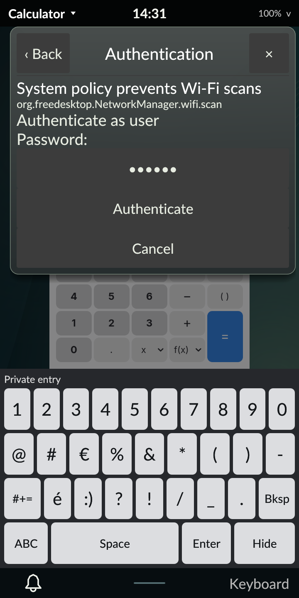

# Authenticated Wi-Fi scanning on the PinePhone Pro

October 30, 2026. Signed revision 53 connects explicit NetworkManager actions to
the existing Polkit agent. The phone defaults to normal Tarot53 with diagnostics
off. This is scoped M4 progress; the full development plan remains active.

## Real mechanism acceptance

Tarot's ordinary UID-10000 graphical process requested scans through the installed
NetworkManager 1.52.2. A temporary restrictive rule required nonretained
`auth_self` only for that verified PID, user and active local session. It granted
no action directly. Real credentials were entered through the shared touch
keyboard, guarded by process/start, cgroup, request/turn, echo-off prompt,
unlocked modal and presented portrait geometry. The installed standard setuid
helper performed PAM; no credential was put in argv, environment or test files.

| Case | NetworkManager result |
| --- | --- |
| Correct password after a delay beyond five seconds | Successful reply and observed new scan |
| Wrong password | Error; cleared entry and static failure |
| Cancel with unsubmitted entry | Error; Wi-Fi page restored |
| Lock with unsubmitted entry | Error; request retired, real PAM unlock |
| Fresh correct-password request after unlock | Successful reply and observed new scan |

Success and cancellation restored the Wi-Fi page. Closing the static failure
also returned to Wi-Fi. Locking discarded the saved destination and did not
reopen it on unlock. The native Calculator card and foreground view survived.
Protected startup covered all four orientations; actual lock PAM, native app,
audio-server availability, clean logout and a fresh normal login also passed.
No tones, Bluetooth peer tests, radio toggles or profile changes were performed.

The rule was removed and Tarot's own fresh GetPermissions restored the original
values. Exact original preferences, policy/rule files, NetworkManager profiles,
active Wi-Fi identity, audio controls and backlight matched their baseline.
NetworkManager and the system bus retained their original process/start identity.
The diagnostic cgroup, control socket and virtual input were removed. A separate
audit verifies default Tarot, actual session/UID/VT7, all four loaded executable
hashes, Panfrost, services, hardware keys and diagnostics/metadata off.

## Host and package acceptance

Current Rust 1.98.1 and minimum 1.89.0 each pass 256 workspace tests; nine tests
remain explicitly ignored. Strict host and AArch64-musl/DRM lint pass for Tarot.
Both frozen compiler builds pass rendered integration with a private broker,
synthetic authority and nonprivileged helper. Existing Wi-Fi credential and
rendered Polkit-agent regressions pass. A fake grant requires a separate helper
response; an agent void reply alone grants nothing.

Private integration additionally covers inventory changes during a pending
dialog, completion observation after the method reply, radio/disconnect/saved
activation, successive network-control/profile-creation prompts, stale replies,
No/missing-agent admission, daemon/authority/broker replacement and fresh-action
recovery without replay. Pending-authorization shutdown completed under 0.03
seconds in both final runs against a six-second limit. This is host protocol
evidence; native radio/profile authorization and daemon restart are not claimed.

The clean Alpine cross-build completed with exit 0 from a source archive
containing 446 checksum-verified locked registry packages. The package audit
verifies AArch64 executables, unchanged PAM/session entry/dependencies and no
installation scripts. Only the four executables and packaged README changed.
Target unit tests were not executed by abuild. Source-package documentation
predates native acceptance; compiled inputs and QA match their frozen manifests.
Final documentation is recorded separately.

| Artifact | SHA-256 |
| --- | --- |
| Source archive | `ec5c887d1109d0a7d7c919f6742cca67a84271040a969e19f54fba7e84a27907` |
| Signed revision-53 APK | `92f86457761200b2945ca9d5d2f1057fb3bead5f6f969ea0403de5ba6f7e962f` |
| Native evidence archive | `05cddf16c12923c2680b3404b773aafbeed64c8667cac0b9758df7c0101cb738` |

All 650 archive members and 614 frozen inputs verify. Complete private reports,
source/binary ledgers and accepted current/minimum runs are retained under
ignored `artifacts/m4/network-authorization/`; the device originals remain in
`/home/user/tarot-dev/network-authorization-r53`. The public
[evidence index](evidence.json) records identities and acceptance boundaries.
The initial staging command found no remote scp binary; the same verified archive
was streamed through SSH before installation. Stopping the idle builder required
SIGKILL after its build had already completed successfully.

## Remaining gates

Native authenticated radio/profile changes, real daemon/broker recovery, broader
authorization policy, hidden/enterprise/VPN setup, profile management and release
reliability remain open. A completed authority grant cannot be revoked by later
local cancellation. This run includes no suspend, live carrier or full-milestone
acceptance. Physical Bluetooth testing remains deferred at the owner's request.
