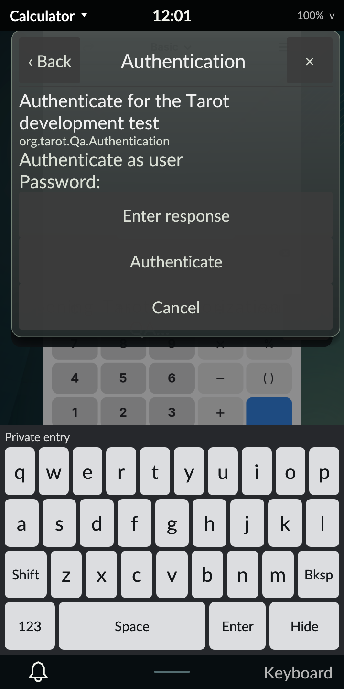

# Polkit authentication on the PinePhone Pro

October 30, 2026. Revision 52 adds the standard Polkit agent, bound to Tarot's
actual local elogind session, and a compositor-owned authentication dialog.
The phone defaults to normal Tarot with diagnostics off. This completes the
scoped agent acceptance; M4 and the full development plan remain in progress.

## Real authority results

An ordinary UID-10000 requester launched through Tarot ran in its graphical PAM
cgroup. A temporary action allowed `auth_self` only for an active local session,
with no retained grant and no privileged operation attached. Independent
CheckAuthorization replies from the system authority were:

| Case | Authorized |
| --- | --- |
| Correct password | Yes |
| Wrong password | No |
| Dialog Cancel | No |
| Requester cancellation | No |
| Verified helper killed before submission | No |
| Lock with unsubmitted entry | No |
| New request while locked | No |
| Lock after valid response queued to stopped helper | No |
| Fresh correct-password request after unlock | Yes |

Real passwords were entered through the actual touch keyboard, with guards for
the process/start identity, cgroup, request/turn, echo-off prompt, unlocked modal
and presented portrait geometry. Credentials and authority cookies were not
written to test reports, argv or environment. Fault injection used a pidfd for
the independently identified installed helper, with real UID 10000, effective
UID 0, the correct parent/cgroup and executable hash.

The temporary policy was deleted and its action disappeared from authority
enumeration. The test login's cgroup, control socket and virtual input were
removed. Exact original preferences, platform policy files, audio and backlight
were restored. A separate audit checks the new normal login, loaded executable
hashes, UID/session/VT7, Panfrost, services, default Tarot and diagnostics off.
The installed Polkit service/helper packages and system bus were unchanged.

## Build and host checks

Current Rust 1.98.1 and minimum Rust 1.89.0 each pass all 251 workspace tests.
Strict host and aarch64-musl/DRM lint pass. Both toolchains pass isolated rendered
agent/helper acceptance; shared Wi-Fi credential and Bluetooth regressions pass.
These use a private broker and a nonprivileged synthetic helper, independently
of the real phone authority checks above.

Private coverage includes another offered account, spoofed/overlapping requests,
stale prompts/cookies, rapid inactive transitions, LockedHint, same-path session
replacement, authority replacement, complete broker restart and malformed,
oversized or hung helpers. A fixture grant requires a separate helper response
to its fake authority; a void agent reply alone cannot grant it.

The source archive contains 446 checksum-verified locked registry packages.
A fresh Alpine cross-build produced the signed AArch64 package; target unit
tests were not executed by abuild. The host build driver ended with status 143,
while its original container build continued to terminal 0. That lifecycle event,
the package and the source manifest were collected without restarting the build.
The independent package audit verifies all four executables, unchanged PAM and
session entry, absent installation scripts, and the added `polkit-elogind`
runtime dependency. Installed changes are the four executables and README.

| Artifact | SHA-256 |
| --- | --- |
| Source archive | `8b2ab9690719e19db6f816fd37947f037bcceaef01f08cfbade01884f2b7ba94` |
| Signed revision-52 APK | `a3a0da25c3ac9d2208848306e0e8628f84b5c21056365a3ea85f97bd47e35c9e` |
| Native evidence archive | `2d249744d813d13441d74137935d26c2dd58916a2aced53a7b0c6e315c40f5f6` |

The private archive has 641 verified members and 610 frozen inputs. Local
reproduction inputs, source/binary ledgers, complete reports and earlier failures
remain under ignored `artifacts/m4/polkit/integration/`; the accepted device
originals are in `/home/user/tarot-dev/polkit-r52`. The public
[evidence index](evidence.json) records the acceptance boundaries and identities.
Source-package documentation predates native acceptance; compiled inputs match
the verified runtime. Later QA/documentation are recorded separately.

The initial restricted host run rejected a private socket operation. A separate
minimum-Rust URI-helper test failed once, then passed unchanged in isolated and
full rechecks; its cause remains unproven. Private-03 exposed a retained modal on
owner replacement; the final code dismisses service-loss prompts and keeps an
explicit authentication failure visible with Close. Failed attempts remain
separate from the accepted current/minimum and native runs.

## Remaining gates

Interactive NetworkManager callers still need their own integration and
acceptance before auth-required controls are enabled. Native system-daemon
restarts, broader authorization policy and release reliability remain open.
Cancellation ends an unfinished conversation; it cannot revoke a grant already
accepted by the authority. This run includes no suspend or live carrier tests.
