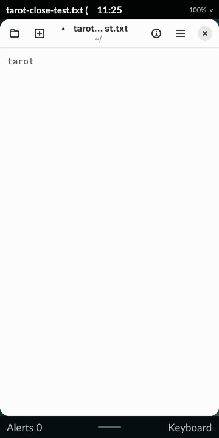

# Native revision 17 visual record

These are actual compositor captures from the spare PinePhone Pro running Nura 26.06, kernel 7.0.0 and Mesa 26.1.6/Panfrost. Tarot runs as UID 10000 through the normal greetd/PAM session. All document text is synthetic; the editor has private HOME/XDG directories. The final audit confirms normal Tarot restored with diagnostics off and original preferences preserved.

| Recording | Demonstrated |
| --- | --- |
| [Launch](launch.gif) · [observations](launch.json) | GNOME Text Editor 50.1 maps as a native application, preserving Calculator |
| [Edit](edit.gif) · [observations](edit.json) | Native text/keyboard resizing, touch keyboard entry and hiding the keyboard |
| [Minimize](minimize.gif) · [observations](minimize.json) | The same live client becomes a rounded card |
| [Browse five](browse-five.gif) · [observations](browse-five.json) | Real horizontal input selects another member of a five-card stack; three previews remain visible |
| [Restore unsaved](restore-unsaved.gif) · [observations](restore-unsaved.json) | A cooperative close request retains the real Save Changes dialog, and touching the card restores it |
| [Save and dismiss](save-and-dismiss.gif) · [observations](save-and-dismiss.json) | Touching the application's Save response writes the exact edited bytes and closes cooperatively |

Readback and PNG encoding perturb rendering. These sparse visual observations do not prove frame pacing, energy use or historical animation conformance. Browse recording begins after horizontal ownership is established, because observing the stationary press first can itself extend the scripted hold into arrangement. There are no interpolated frames. Identical quantized GIF frames may coalesce; sidecars distinguish encoded frame counts from actual capture counts. GIFs resize and quantize colors, round observed capture intervals to 10 ms and add an explicit 400 ms endpoint display hold. Original PNGs and timestamps are retained in the local evidence archive; pixel assertions use those PNGs, not these derivatives.

Each JSON sidecar includes source-image hashes, output/pose metadata, capture times, export treatment and exact package/binary identities. Export uses [export-motion.py](../../../scripts/export-motion.py). The complete passing three/five-card matrix additionally verifies all orientations, actual activation/pixels for every member, independent cooperative close and preservation of the original app. The editor replay separately verifies touch Cancel before Save; a second authenticated session checks persistence. Both sessions request zero kernel-suspend cycles. Manual physical-finger behavior and general transient-toplevel parenting are separate open gates.

Installed APK SHA-256: `606c467d5d8f4f87299ba3d5f0d54238266a219c306b464ca4403e59375118c1`. Compositor SHA-256: `177a60c0b6fbe09d3ab2bddd46a69f8f79cbbc3665f8d735a2f992f4b37dab66`.

Raw evidence remains under ignored `artifacts/m1/stack-matrix/native-r17-final-evidence.tar.gz`; the failed initial recording attempt and revision 16 editor preflight are retained separately. [Implementation scope and remaining work](../../IMPLEMENTATION_STATUS.md#larger-stacks-and-real-gtk-close-checkpoint).

A [second clean build](reproducibility.json) from the final QA/documentation source snapshot produces identical four executables and the same signed APK. Both signatures verify. This comparison uses the same pinned Alpine/SDK builder; it does not certify cross-machine reproducibility.
